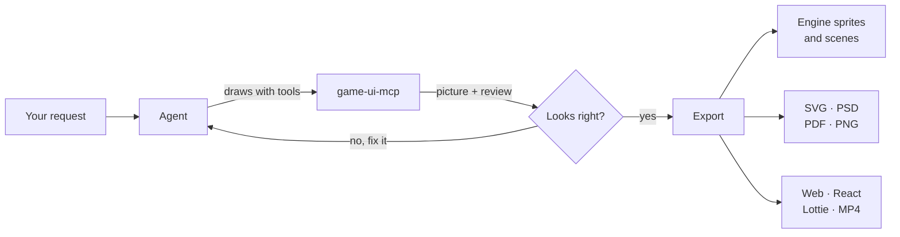
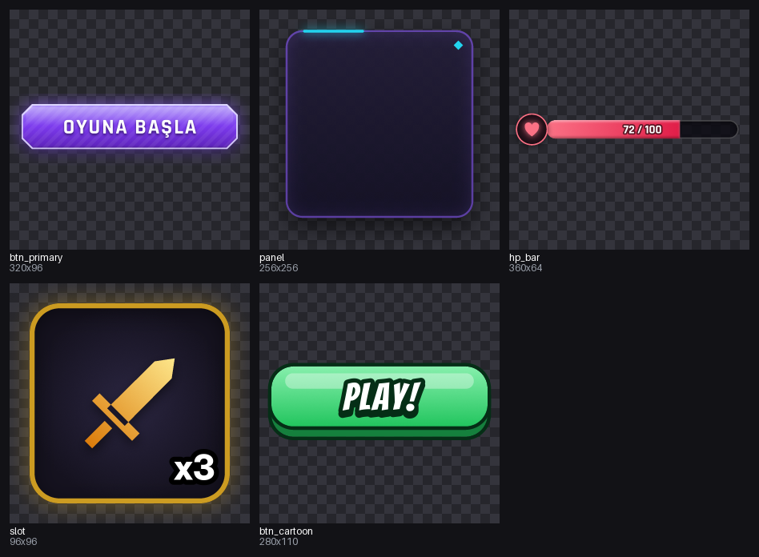
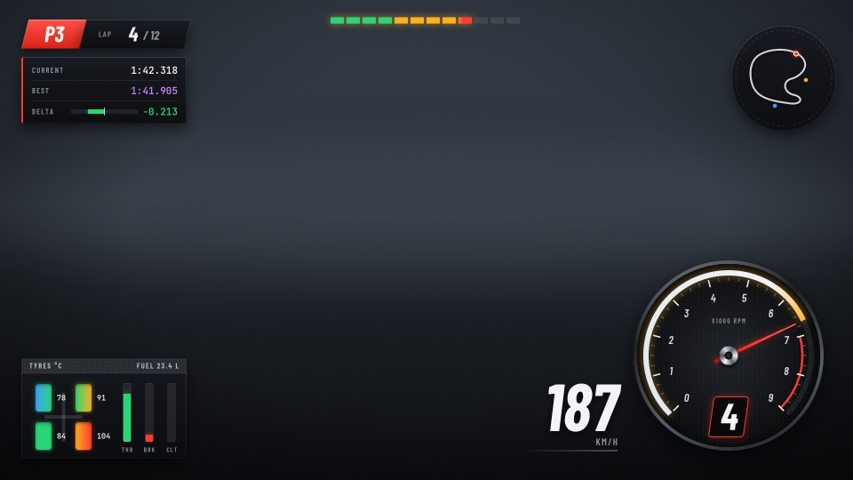
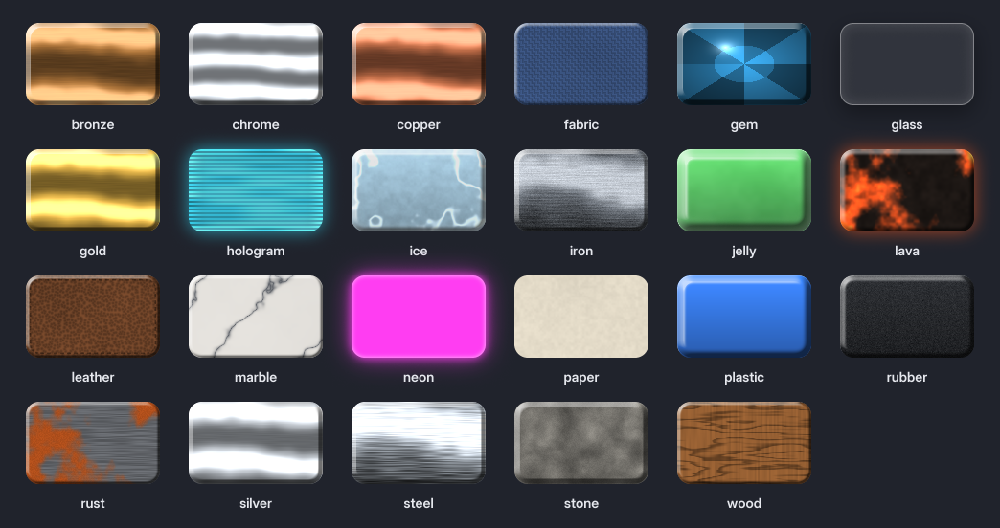
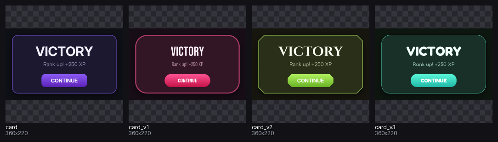
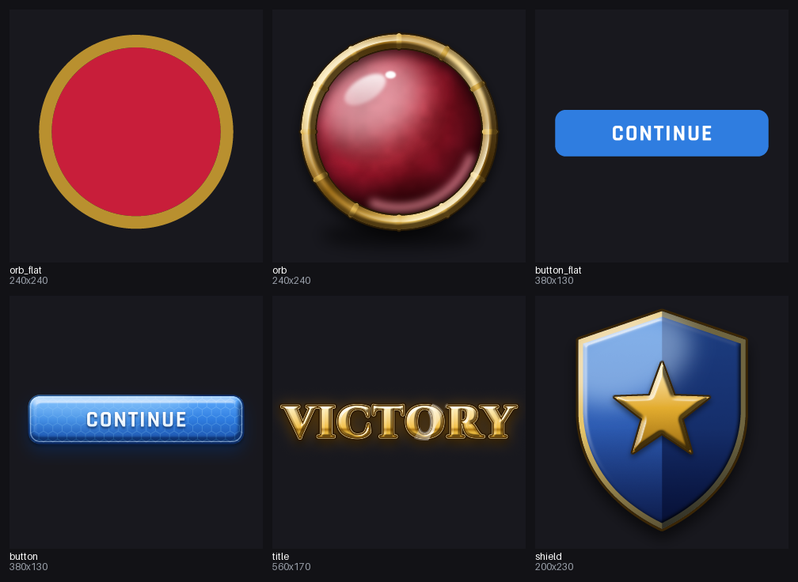
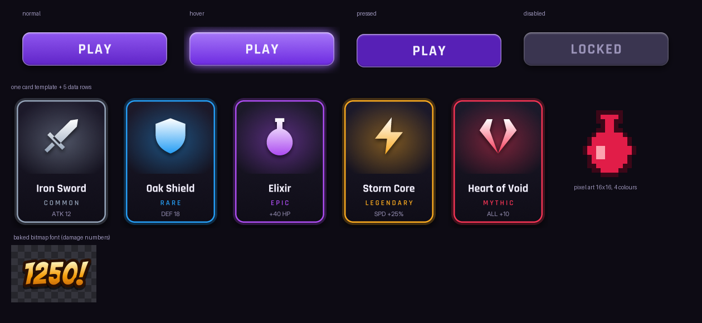
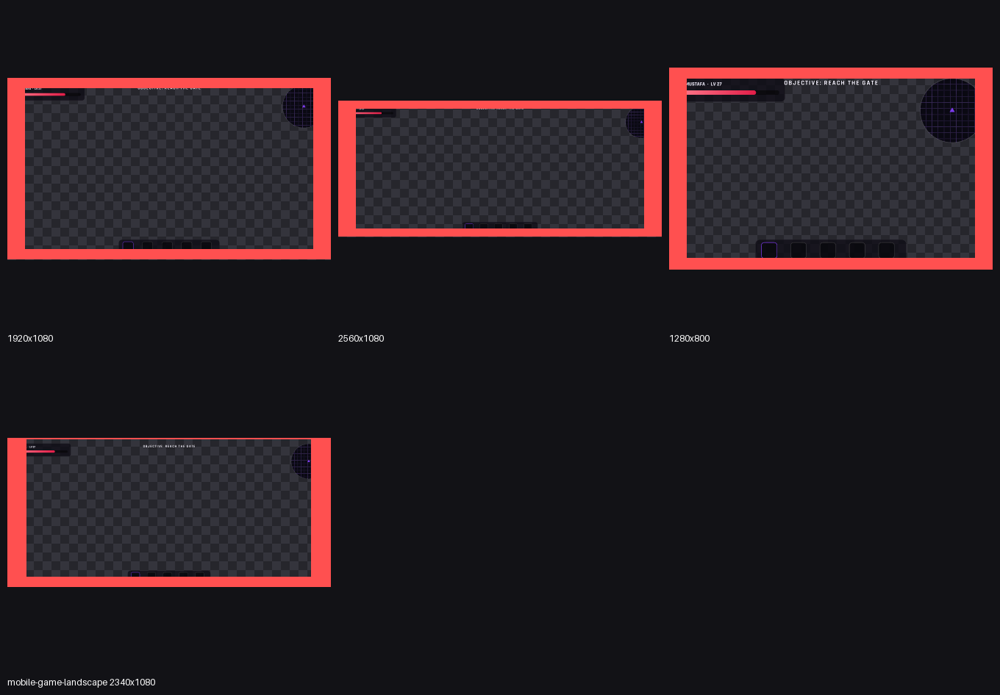

<div align="center">

**English** · [Türkçe](README.tr.md)

# game-ui-mcp

### One MCP for designing, animating and shipping game and app UI.

**Describe a screen. Get engine-ready art, animation and code.**

[](https://github.com/TENETTE/game-ui-mcp/actions/workflows/tests.yml)
[](#tools)
[](#quick-start)
[](#quick-start)
[](LICENSE)

[Quick start](#quick-start) · [How it works](#how-it-works) · [What you can ship](#what-you-can-ship) · [Showcases](#showcases) · [Features](#features) · [FAQ](#faq) · [Documentation](#documentation)

<code>claude mcp add game-ui -s user -- uvx --from git+https://github.com/TENETTE/game-ui-mcp game-ui-mcp</code>

<br /><br />


</div>

---

Need a menu, a HUD, a health bar or a whole settings screen? Ask your AI agent. game-ui-mcp gives it the drawing tools of a design app: shapes, text, layers, lighting, materials, auto layout, components and keyframe animation. The agent draws, looks at the result, finds its own mistakes and fixes them.

When the design is right, the same canvas goes out as whatever you need: 9-slice sprites and scenes for Unity, Unreal, Godot and Roblox, editable SVG and PSD, PDF, Lottie, MP4, a working website or React components with their interactions.

Everything runs locally. There is no image model and no internet access: every pixel comes from the tools the agent calls, so results are clean, repeatable and editable.

## Quick start

### Set up your agent

You need [uv](https://docs.astral.sh/uv/) (`winget install astral-sh.uv`, `brew install uv` or `pip install uv`). The first start downloads everything (about 30 seconds).

**Claude Code**

```bash
claude mcp add game-ui -s user -- uvx --from git+https://github.com/TENETTE/game-ui-mcp game-ui-mcp
```

**Claude Desktop, Cursor, Windsurf and other MCP clients** (in VS Code, `.vscode/mcp.json` uses `servers` instead of `mcpServers`):

```json
{
  "mcpServers": {
    "game-ui": {
      "command": "uvx",
      "args": ["--from", "git+https://github.com/TENETTE/game-ui-mcp", "game-ui-mcp"]
    }
  }
}
```

Restart the client afterwards.

<details>
<summary>GPU build, video export and the skill</summary>

**GPU.** With an NVIDIA card, the `[gpu]` build computes shader fills, materials and large blurs on the GPU (CuPy + CUDA 12, about 1 GB to download; 9-11x faster on an RTX 4060 Ti). Without a working CUDA device it falls back to the CPU with identical results. `GAME_UI_MCP_GPU=0` turns it off.

```bash
claude mcp add game-ui -s user -- uvx --from "game-ui-mcp[gpu] @ git+https://github.com/TENETTE/game-ui-mcp" game-ui-mcp
```

**Video.** MP4 / WebM export uses `ffmpeg` from your PATH (`winget install ffmpeg`, `brew install ffmpeg`), or the `[video]` extra installs one.

**Skill.** [`skill/game-ui-mcp/SKILL.md`](skill/game-ui-mcp/SKILL.md) teaches the agent the craft: themes, layer order, lighting, 9-slice rules, animation timing, interactions, a review pass and engine hand-off. In Claude Code, copy the folder to `~/.claude/skills/`. In the Claude apps, zip the folder and upload it under Settings → Capabilities → Skills.

</details>

### Ask your agent

```text
Design a main menu for a sci-fi game: title, four buttons with hover and press
states, a settings dialog. Check it, then export it as a website I can click
through and as 9-slice sprites for Unity.
```

More ideas:

- "Make a rev gauge for a racing game with a needle animation, and give me the parts as separate layers in `D:\Game\UI`."
- "Show me three different directions for this victory screen, then keep the second one."
- "Build a gold-trimmed inventory panel with stone and leather materials."
- "Translate this menu to Arabic and Japanese and check for overflowing text."
- "Turn this card animation into an MP4 for the store page."
- "Export the theme as a DESIGN.md for my coding agent."

### Update

`uvx` keeps a cached copy. To get the latest version, clear it and restart your client:

```bash
uv cache clean game-ui-mcp
```

## How it works

Your agent calls the tools over MCP. The server keeps the canvases, renders them and answers with a picture, so the agent can look at what it drew. `review_canvas` adds a written check (clipped shadows, low contrast, overflowing text, missing glyphs, half-pixel blur, inconsistent radii). The agent fixes what it finds, then exports.



## What you can ship

| Target | What you get | Tools |
| --- | --- | --- |
| Unity | 9-slice sprites with an import helper, UI Toolkit screens (UXML + USS), C# tokens | `export_asset`, `export_screen`, `write_engine_helpers` |
| Unreal | Box brushes with margins, an editor import script | `export_asset`, `write_engine_helpers` |
| Godot 4 | `.tscn` scenes, `StyleBoxTexture` resources, GDScript tokens | `export_screen`, `export_asset` |
| Roblox | A LocalScript screen, slice centers, Luau tokens | `export_screen`, `export_asset` |
| Animated parts | Separate layers with pivots, sprite sheets, tween JSON with Roblox and DOTween ease names | `export_layers`, `export_animation` |
| Websites | HTML / CSS pages with real text, links, overlays, hover states, animations and interactions | `export_web` |
| React | One JSX + CSS component per screen, images imported, interactions included | `export_react` |
| Mobile and desktop apps | iOS / Android / web density sets, app icons, ICO | `export_png` |
| Design apps | Editable vector SVG, layered PSD | `export_svg`, `export_psd` |
| Print and review | Multi-page vector PDF | `export_pdf` |
| Apps and players | Lottie with vector shape layers | `export_animation` |
| Video | MP4 (H.264) or transparent WebM | `export_animation` |
| Developers and agents | Specs, tokens (CSS, USS, DTCG, C#, GDScript, Luau), DESIGN.md | `export_spec`, `export_theme` |

## Showcases

Every picture here is drawn by the server itself; the scripts in [`examples/`](examples) rebuild them.

### A full UI kit

Buttons, panels, bars, slots and badges from one theme, checked side by side with `contact_sheet`.



### A realistic racing HUD

Dark glass panels, carbon and brushed metal, a rev gauge with ticks, a needle and LED segments, telemetry in fixed-width digits.



### Materials

23 procedural materials, each tintable, seedable and animatable. Define your own in the theme, from a built-in one or from scratch with a shader formula.



### Design variations

`make_variations` explores palette, shape and type directions in one call and lays them out next to the original.



### Design tools in one screen

Boolean shapes, smoothed corners, fill stacks, wrapping layout, frosted glass, single-side strokes, truncated text and light / dark modes, also exported as an [editable SVG](examples/design_tools.svg).


### Animation

| Button entrance + shine | Rev gauge | Menu entrance and selection |
| --- | --- | --- |
|  |  |  |

<details>
<summary>More examples</summary>

**Lighting and shading.** Flat shapes turned into glass, metal and plastic with layers, clipping and directional light.



**Painting in layers.** Ground shadow, body, shade (multiply), light (screen) and a rim, each on its own layer.


**Realistic kit.** Carbon, glass, turned metal and a boost gauge.


**Components, states and data.** One button with four states, item cards generated from data rows, pixel-art mode.



**Multi-resolution.** One HUD pinned to screen edges, checked at 16:9, 21:9 and phone sizes.



</details>

## Features

- **Shapes:** rects with round, cut or smoothed corners, ellipses, polygons and stars, lines with arrow heads and tapering, arcs, gauge ticks, SVG paths and import, exact booleans, offset / outline / flatten, components, linear and circular arrays, image vectorising.
- **Style:** solid, linear / radial / conic / diamond gradients (OKLab), patterns, fill stacks, your own per-pixel shader formulas, 23 ready materials plus your own, multiple strokes, shadows, glows, inner effects, bevel, directional 3D lighting, frosted and refracting glass, progressive blur, feathered edges, grain, edge texture, masks, 13 blend modes, layers with clipping.
- **Images:** crop, background cut-out, pan and zoom inside any shape, animated GIF / APNG / WebP and sprite sheets, sub-pixel smooth motion.
- **Text:** 10 bundled fonts plus system fonts, Arabic, Hebrew, Indic, Thai and CJK shaped with HarfBuzz, colour emoji, OpenType features, variable axes, lists, text on arcs and paths, truncation, text to outlines, missing-glyph checks.
- **Design system:** colour and number tokens, light / dark / team modes, named styles, generated palettes with contrast checks, W3C DTCG and DESIGN.md import / export, kit-wide restyling, version history.
- **Layout:** live auto layout (row / column / grid, wrap, hug, fill, min / max, spans), pins to screen edges, device presets with safe areas, multi-resolution preview, colour-blindness simulation.
- **Components and data:** instances, variants, slots, optional parts, interaction states, templates from data rows, string tables with pseudo-localisation.
- **Animation:** keyframes on any property with 30+ eases (spring included), motion paths, staggering, motion blur, filmstrip preview.
- **Interaction:** a state machine (hover, press, click, keys, animation chains, states, navigation) that runs in web and React output and is listed for engine code.
- **Review:** `preview` with zoom and regions, `review_canvas` lint, pixel inspection, contact sheets, design variations.

The full reference with style keys, layers, animation and engine tables is in **[docs/GUIDE.md](docs/GUIDE.md)** (Turkish).

## Tools

<details>
<summary><strong>All 85 tools</strong></summary>

| Group | Tools |
| --- | --- |
| Canvas | `create_canvas`, `list_canvases`, `get_canvas`, `update_canvas`, `duplicate_canvas`, `delete_canvas`, `fit_canvas`, `resize_canvas`, `canvas_version` |
| Layers | `create_layer`, `update_layer`, `delete_layer`, `set_layer` |
| Drawing | `add_rect`, `add_ellipse`, `add_line`, `add_polygon`, `add_path`, `add_arc`, `add_ticks`, `add_text`, `add_image`, `add_instance`, `add_svg` |
| Editing | `update_element`, `delete_elements`, `duplicate_element`, `boolean_elements`, `path_ops`, `restyle`, `find_elements`, `vectorize_image`, `move_elements`, `reorder_element`, `align_elements`, `arrange_elements`, `scatter`, `copy_elements`, `set_pin`, `batch`, `undo`, `redo` |
| States, data, language | `set_state`, `delete_state`, `generate_from_template`, `set_strings`, `get_strings` |
| Checks | `review_canvas`, `inspect_pixels`, `view_image`, `preview_nine_slice` |
| Animation | `create_animation`, `set_keyframes`, `delete_keyframes`, `get_animations`, `delete_animation`, `preview_animation`, `export_animation` |
| Theme and info | `set_theme`, `get_theme`, `make_palette`, `list_fonts`, `measure_text`, `guide` |
| Preview and explore | `preview`, `preview_resolutions`, `contact_sheet`, `make_variations` |
| Export | `export_png`, `export_svg`, `export_pdf`, `export_web`, `export_react`, `export_asset`, `export_layers`, `export_psd`, `export_atlas`, `export_bitmap_font`, `write_engine_helpers` |
| Hand-off | `export_spec`, `export_theme`, `set_link`, `set_interaction`, `export_prototype`, `export_screen` |

Look-only tools (`preview`, `get_*`, `review_canvas`...) are marked read-only and `delete_*` destructive, so clients can skip or ask for approval. Every error tells the agent what was wrong and how to fix it.

</details>

## FAQ

<details>
<summary><strong>Which agents can use it?</strong></summary>

Any client that supports local MCP servers: Claude Code, Claude Desktop, Cursor, Windsurf, VS Code and others. See [Quick start](#quick-start).

</details>

<details>
<summary><strong>Does it use an image model or the internet?</strong></summary>

No. The agent builds everything from shapes, text and effects, and the server renders them locally. Nothing is uploaded; your agent's model provider sees the tool results under its own data policy.

</details>

<details>
<summary><strong>Can it draw characters, illustrations or photos?</strong></summary>

No, that is not what it is for. It draws interface art. Place existing art with `add_image`, which can crop it, cut out a flat background, pan and zoom it, or play it as an animation.

</details>

<details>
<summary><strong>Where are my files?</strong></summary>

Canvases, the theme and exports live in `~/GameUI` and survive restarts. Set `"env": {"GAME_UI_MCP_DIR": "D:\\UI"}` in the client config for another folder. Fonts dropped into `~/GameUI/fonts/` become available.

</details>

<details>
<summary><strong>Are the engine files tested inside the engines?</strong></summary>

Yes. They are generated, format-tested and tested in Unity, Unreal, Godot and Roblox. If an import fails, the error message usually tells the agent what to change; please also [open an issue](https://github.com/TENETTE/game-ui-mcp/issues).

</details>

<details>
<summary><strong>How much context do the tools take?</strong></summary>

The 85 tool definitions take about 30k tokens. Clients that load tools on demand (Claude Code) pay much less. Long references live behind the `guide` tool instead of the server instructions.

</details>

<details>
<summary><strong>What should I do if I hit a bug?</strong></summary>

[Update](#update) first. If it persists, [open an issue](https://github.com/TENETTE/game-ui-mcp/issues) with what you asked, the tool call and the error message.

</details>

## Documentation

- [Guide](docs/GUIDE.md) (Turkish): every feature, style key, layer rule, animation and engine table, and the limits.
- [Skill](skill/game-ui-mcp/SKILL.md) (Turkish): the workflow and craft rules the agent follows.
- [Changelog](CHANGELOG.md): what changed in each version.
- In the agent, `guide(topic)` returns the full reference for fills, shaders, style, design, layers, geometry, text, reuse, review, animation and export.

## Security

- No network access. Generated engine scripts are written, never run. Shader formulas are a whitelisted maths language that cannot touch files or the system.
- Values written into engine scripts are allow-listed, SVG DOCTYPE / ENTITY declarations are refused, and oversized renders and heavy formulas are refused before they start.
- Export tools write to the folder you give them and overwrite files with the same name.

Report vulnerabilities privately as described in [SECURITY.md](SECURITY.md).

## Contributing

Bug reports, ideas and pull requests are welcome: [open an issue](https://github.com/TENETTE/game-ui-mcp/issues) or [send a pull request](https://github.com/TENETTE/game-ui-mcp/pulls).

```bash
git clone https://github.com/TENETTE/game-ui-mcp
cd game-ui-mcp
uv venv && uv pip install -e ".[dev]"
uv run pytest
```

`python examples/run_all.py` rebuilds every picture in this README. See [CONTRIBUTING.md](CONTRIBUTING.md).

## License

[MIT](LICENSE): free for any use, including commercial. Bundled fonts are under the SIL Open Font License (`OFL.txt` in each font folder). What you draw with it is yours.

Figma, Penpot, Unity, Unreal Engine, Godot, Roblox, Photoshop, Illustrator, Inkscape, React and other product names are trademarks of their owners. This project is not affiliated with or endorsed by them; the names only describe compatibility.
