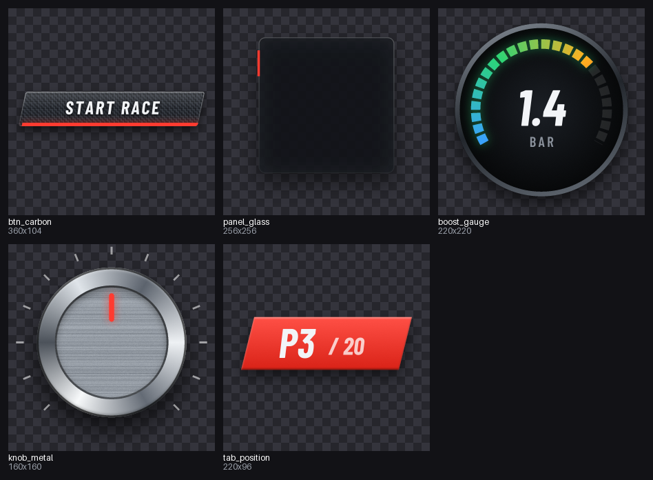
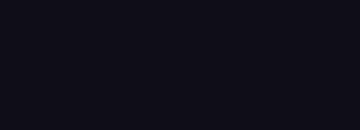

# game-ui-mcp

Claude'un (ya da MCP destekleyen başka bir AI'ın) **oyun UI'ı çizmesini** sağlayan, tamamen yerel çalışan bir MCP server.

İçinde görsel üreten bir AI modeli yok ve internete bağlanmıyor. Hazır bileşen de yok: "buton" ya da "panel" diye bir tool bulunmuyor, yalnızca temel gereçler var (şekil, yazı, stil, keyframe). Ne çıkacağını ve ne kadar iyi olacağını modelin kendi tasarım kararları belirliyor. AI, "dikdörtgen çiz, içine şunu yaz, glow ekle" gibi tool'ları çağırır; server bunları temiz, kenarı yumuşatılmış PNG'ye çevirir, AI kendi çizdiğine bakıp düzeltir ve Unity / Unreal Engine / Roblox Studio için dışa aktarır.


Gerçekçi tarz (yarış, simülasyon, AAA) da çizebiliyor: kadran, ibre, karbon ve metal doku, eğik sekmeler, cam paneller.




Animasyon da aynı mantıkla çalışıyor: hazır efekt yok, keyframe ve ease var.

| Buton girişi + parlama | Devir saati | Menü girişi ve seçim |
| --- | --- | --- |
|  |  |  |

Görsellerin tamamı [`examples/demo.py`](examples/demo.py), [`examples/demo_racing.py`](examples/demo_racing.py) ve [`examples/demo_animation.py`](examples/demo_animation.py) içindeki tool çağrılarıyla çizildi. (GIF'ler 256 renkle sınırlı olduğu için gerçek çıktıdan biraz daha kaba görünür.)

## Ne yapabiliyor

- **Şekiller:** dikdörtgen (yuvarlak ya da kesik köşe, eğik), elips, çokgen, yıldız, çizgi (kesikli olabilir), yay, kadran çizgileri, SVG path
- **Stil:** düz renk, linear / radial / conic gradient, çizgili / noktalı / ızgara / karbon / fırçalı metal doku, kenar çizgisi (iç, orta, dış), gölge, glow, iç gölge, bevel, bulanıklık, opaklık, karışım modları, bir pivot etrafında döndürme, başka bir şekle kırpma (`clip`)
- **Gösterge:** `add_arc` + `add_ticks` ile devir saati, hız göstergesi, turbo, segmentli LED sıraları; ibre için pivot'lu döndürme
- **Yazı:** 10 gömülü font (Inter, Barlow Condensed, Bebas Neue, Michroma, JetBrains Mono, Rajdhani, Orbitron, Cinzel, Fredoka, Bangers) + bilgisayardaki fontlar, italik, satır kaydırma, genişliğe sığdırma, kontur, Türkçe büyük harf (`uppercase: "tr"`)
- **İkon:** 72 hazır oyun ikonu, çizgi ve dolu hali ([hepsi](examples/icons.png))
- **Animasyon:** keyframe + ease ile her özellik canlandırılır (konum, ölçek, dönme, opaklık, renk, efekt, yay açısı, yazı); film şeridi önizlemesi; sprite sheet, kare dizisi, GIF / APNG / WebP ya da motorun kendi tween'i için keyframe JSON çıktısı
- **Tema:** renk token'ları (`$primary`) ve isimli stiller; bütün kit tutarlı kalır
- **Önizleme:** AI çizdiğini resim olarak geri görür (yakınlaştırma, eleman kutuları, oyun sahnesi arka planı)
- **Dışa aktarma:** PNG (1x, 2x), otomatik 9-slice, atlas, parça parça katman çıktısı (ibre, kadran, yay ayrı), motor başına hazır değerler ve yardımcı scriptler

## Kurulum (Windows)

Python 3.10 ya da üstü gerekli.

```powershell
git clone https://github.com/TENETTE/game-ui-mcp
cd game-ui-mcp
python -m venv .venv
.venv\Scripts\pip install -e .
```

Deneme (örnek görselleri yeniden üretir):

```powershell
.venv\Scripts\python examples\demo.py
.venv\Scripts\python examples\demo_racing.py
.venv\Scripts\python examples\demo_animation.py
```

### Claude Desktop'a bağlama

`claude_desktop_config.json` dosyasına ekle (Windows'ta `%APPDATA%\Claude\` klasöründe; uygulamada Ayarlar → Developer → Edit Config ile de açılır, menü adı sürüme göre değişebilir):

```json
{
  "mcpServers": {
    "game-ui": {
      "command": "C:\\Users\\SEN\\game-ui-mcp\\.venv\\Scripts\\python.exe",
      "args": ["-m", "game_ui_mcp"]
    }
  }
}
```

Yolu kendi klasörüne göre değiştir, Claude Desktop'ı tamamen kapatıp aç.

### Claude Code'a bağlama

```powershell
claude mcp add game-ui -- C:\Users\SEN\game-ui-mcp\.venv\Scripts\python.exe -m game_ui_mcp
```

### Skill

`skill/game-ui-mcp/SKILL.md`, Claude'a bu tool'ları iyi kullanmayı öğretir (tema kurma, katman sırası, 9-slice kuralları, kontrol turu, motor tarafı). Claude'da skill olarak ekle; Claude Code kullanıyorsan klasörü `.claude/skills/` altına kopyala.

## Dosyalar nereye gidiyor

Varsayılan çalışma klasörü `C:\Users\SEN\GameUI`:

| Klasör | İçerik |
| --- | --- |
| `projects/` | Canvas'lar (JSON). Oturum kapansa da kalır. |
| `exports/` | Yol verilmeden yapılan dışa aktarmalar |
| `fonts/` | Buraya attığın `.ttf` / `.otf` dosyaları font listesine girer |
| `theme.json` | Renk token'ları ve stiller |

Başka bir klasör için `GAME_UI_MCP_DIR` ortam değişkenini ayarla (config'te `"env": {"GAME_UI_MCP_DIR": "D:\\UI"}`).

## Tool'lar

| Grup | Tool'lar |
| --- | --- |
| Canvas | `create_canvas`, `list_canvases`, `get_canvas`, `update_canvas`, `duplicate_canvas`, `delete_canvas` |
| Çizim | `add_rect`, `add_ellipse`, `add_line`, `add_polygon`, `add_path`, `add_arc`, `add_ticks`, `add_text`, `add_icon`, `add_image` |
| Düzenleme | `update_element`, `delete_elements`, `duplicate_element`, `move_elements`, `reorder_element`, `align_elements`, `batch`, `undo` |
| Animasyon | `create_animation`, `set_keyframes`, `delete_keyframes`, `get_animations`, `delete_animation`, `preview_animation`, `export_animation` |
| Tema ve bilgi | `set_theme`, `get_theme`, `list_fonts`, `list_icons`, `measure_text` |
| Önizleme | `preview`, `contact_sheet` |
| Dışa aktarma | `export_png`, `export_asset`, `export_layers`, `export_atlas`, `write_engine_helpers` |

Stil nesnesi kısaca:

```json
{
  "fill": {"type": "linear", "angle": 90, "stops": [[0, "#a78bfa"], [1, "#5b21b6"]]},
  "stroke": {"color": "$primary@0.6", "width": 2, "align": "inside"},
  "shadow": {"color": "#000000@0.5", "blur": 12, "dy": 6},
  "glow": {"color": "$accent", "blur": 16},
  "inner_shadow": {"color": "#000@0.6", "blur": 8, "dy": 2},
  "bevel": {"size": 2},
  "opacity": 1.0
}
```

Renkler: `#rrggbb`, `#rrggbbaa`, `rgba(...)`, `$token`; sonuna `@0.5` eklenince alfa olur.

Açılar (yay, kadran çizgisi, conic gradient): derece, 0 = saat 3 yönü, saat yönünde artar. Klasik bir gösterge 135'ten 405'e süpürür.

## Animasyon

Bir animasyon, canvas'a bağlı bir keyframe kümesidir. Her iz (track) bir elemanın ya da bir grubun tek bir özelliğini zaman içinde değiştirir:

```json
{"animation": "appear", "target": "group:btn", "property": "scale", "pivot": [180, 64],
 "keyframes": [[0, 0.55], [0.28, 1, "back-out"]]}
```

- **Özellikler:** yardımcılar `dx`, `dy`, `scale`, `scale_x`, `scale_y`, `opacity`; her sayısal eleman özelliği (`x`, `width`, `rotation`, `end_angle`, `dash_offset`, ...); stil yolları (`style.glow.blur`, `style.fill`, `style.stroke.color`); adım adım değişenler (`text`, `visible`).
- **Ease:** `linear`, `step`, `ease-in/out/in-out` ve stil + yön: `sine`, `quad`, `cubic`, `quart`, `quint`, `expo`, `circ`, `back`, `elastic`, `bounce` × `in`, `out`, `in-out` (ör. `back-out`); ya da cubic-bezier `[x1, y1, x2, y2]`. Bir keyframe'deki ease o keyframe'e varışı şekillendirir.
- **Önizleme:** `preview_animation` animasyonu zaman etiketli kareler halinde yan yana gösterir; model hareketi buradan okur.
- **Çıktı (`export_animation`):** `json` (motorun kendi tween'i için; ease'lerin Roblox TweenService ve DOTween adlarıyla), `spritesheet`, `frames`, `gif`, `apng`, `webp`.

## Motorlara aktarma

`export_asset` PNG'nin yanına `<ad>.gameui.json` yazar ve klasördeki `game_ui_manifest.json` dosyasını günceller. `nine_slice: "auto"` esneyecek orta bölgeyi kendisi bulur ve dokuyu küçültür.

| Motor | 9-slice değeri | Yardımcı (`write_engine_helpers`) |
| --- | --- | --- |
| Unity | Sprite border (L, B, R, T) | `GameUiImporter.cs`: yanında `.gameui.json` olan her PNG'yi UI sprite olarak ayarlar |
| Unreal | Brush `Draw As: Box`, Margin (L, T, R, B, 0-1) | `import_game_ui.py`: texture'ları UI ayarlarıyla içe aktarır, margin'leri log'a yazar |
| Roblox | `SliceCenter`, `SliceScale` | `GameUiAssets.luau`: `GameUi.apply(imageLabel, "ad")` |

Hareketli parçalar (ibre, dolan yay) için `export_layers`: her `group` ayrı PNG olur, `<ad>.layout.json` her parçanın konumunu ve dönme merkezini verir. Assetto Corsa (CSP Lua) gibi PNG kullanan her ortamda bu çıktılar doğrudan kullanılabilir.

Roblox'ta görselleri Studio'ya kendin yüklemen gerekir (server internete çıkmaz); asset id'lerini sonra `write_engine_helpers(roblox_ids=...)` ile işlersin.

## Sınırlar

- Karakter portresi, illüstrasyon, fotoğraf gibi şeyleri üretmez. Bunlar için hazır bir görseli `add_image` ile yerleştirebilirsin.
- Stroke birleşimleri çokgen ve path'lerde yuvarlaktır (dikdörtgenlerde keskin).
- Arka planı bulanıklaştıran gerçek "buzlu cam" PNG'ye gömülemez; o efekt motor tarafında yapılır (Unreal'da `BackgroundBlur`). Burada camın koyu, yarı saydam hali çizilir.
- Animasyon çıktısı veri ve görseldir; motor içinde oynatan kodu (TweenService, DOTween, UMG) model yazar. Büyük canvas'larda kare kare çıktı yavaştır (1920×1080 ve 80 eleman için kare başına yaklaşık 1 sn).
- Çok büyük blur'lu gölgelerde 8 bit bantlanma görülebilir (gradient'ler dither'lanır, gölgeler dither'lanmaz).
- Yazıda harf aralığı verilince kerning uygulanmaz.
- Orbitron fontunda Ğ / ğ yok; tool böyle durumlarda uyarı döndürür.
- Motor tarafındaki yardımcı dosyalar (C#, Unreal Python, Luau) bu repoda yalnızca üretiliyor; Unity, Unreal ve Roblox Studio içinde henüz denenmedi.

## Geliştirme

```powershell
.venv\Scripts\pip install -e ".[dev]"
.venv\Scripts\python -m pytest
```

Çizim motoru Pillow + numpy üzerine kurulu: şekiller 4 kat çözünürlükte piksel merkezine göre taranır, sonra küçültülür; efektler çıkış çözünürlüğünde uygulanır. MCP Python SDK'nın 1.x ve 2.x sürümleriyle çalışır.

## Fontlar

`src/game_ui_mcp/assets/fonts/` altındaki fontlar SIL Open Font License ile dağıtılır; her klasörde `OFL.txt` bulunur.
