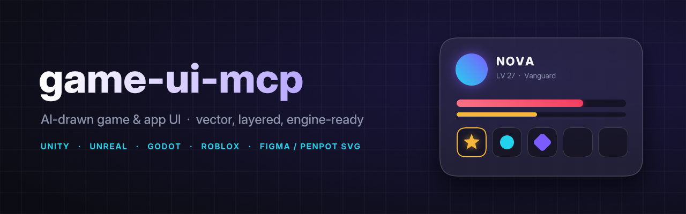
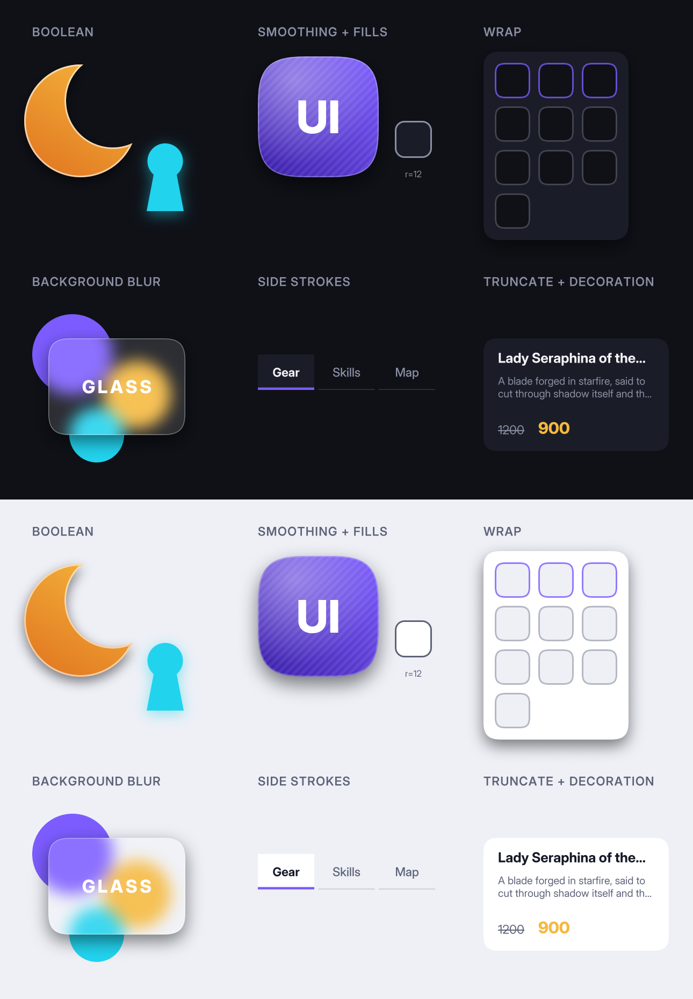
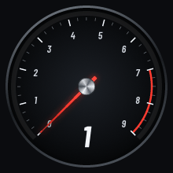

<p align="center"></p>

<p align="center">
  <a href="https://github.com/TENETTE/game-ui-mcp/actions/workflows/tests.yml"></a>
  <a href="LICENSE"></a>
  
  
  
</p>

<p align="center"><b>English</b> · <a href="README.tr.md">Türkçe</a></p>

# game-ui-mcp

A local [MCP](https://modelcontextprotocol.io) server that lets an AI (Claude, Cursor, VS Code Copilot, any MCP client) **draw, animate and ship game and app UI**: panels, buttons, HUDs, gauges, menus, icons and whole screens, ready for Unity, Unreal, Godot, Roblox, Figma and Penpot.

- **No image model, no internet.** The AI calls shape, text, style and keyframe tools; the server turns them into clean, deterministic vector-quality art.
- **It checks its own work.** `preview` shows the AI what it drew, `review_canvas` finds clipped shadows, low contrast, overflowing or missing-glyph text, blurry half-pixel edges.
- **Engine-ready output.** 9-slice sprites, layers, PSD, editable vector SVG, iOS / Android density sets, sprite sheets, and scenes (Godot `.tscn`, Unity UXML/USS, Roblox Luau).


Design-tool features in one screen (boolean shapes, smoothed corners, fill stacks, wrapping layout, frosted glass, single-side strokes, truncated text, light / dark modes), also exported as an [editable SVG](examples/design_tools.svg):



| Button entrance + shine | Rev gauge | Menu entrance and selection |
| --- | --- | --- |
|  |  |  |

## Install

You need [uv](https://docs.astral.sh/uv/) (`winget install astral-sh.uv`, `brew install uv` or `pip install uv`). No clone, venv or Python path needed; the first start downloads everything (~30 s).

**Claude Code**

```bash
claude mcp add game-ui -s user -- uvx --from git+https://github.com/TENETTE/game-ui-mcp game-ui-mcp
```

**Claude Desktop, Cursor, Windsurf** (the client's MCP config file; in VS Code `.vscode/mcp.json` uses `servers` instead of `mcpServers`):

```json
{
  "mcpServers": {
    "game-ui": {
      "command": "uvx",
      "args": ["--from", "git+https://github.com/TENETTE/game-ui-mcp", "game-ui-mcp"]
    }
  }
}
```

**CPU or GPU build.** The default (`[cpu]`) runs everywhere. With an NVIDIA card, `[gpu]` computes shader fills and large blurs on the GPU (CuPy + CUDA 12, ~1 GB download; 9-11x faster on an RTX 4060 Ti). Pick it in the package name:

```bash
claude mcp add game-ui -s user -- uvx --from "game-ui-mcp[gpu] @ git+https://github.com/TENETTE/game-ui-mcp" game-ui-mcp
```

Without a working CUDA device the `[gpu]` build quietly falls back to the CPU with identical results; `GAME_UI_MCP_GPU=0` turns it off.

**Optional skill:** [`skill/game-ui-mcp/SKILL.md`](skill/game-ui-mcp/SKILL.md) teaches the model the craft (themes, layer order, lighting, 9-slice rules, a review pass, engine hand-off). In Claude Code copy the folder to `~/.claude/skills/`.

## Try asking

- "Draw a gold-trimmed inventory panel and a three-state button for a fantasy RPG, export them to Unity as 9-slice."
- "Make a rev gauge for a racing game with a needle animation, and give me the parts as separate layers in `D:\Game\UI`."
- "Translate this main menu to Arabic and Japanese and check for overflowing text."
- "Take the palette from this screenshot and build a scoreboard in the same style, light and dark."
- "Design an iOS app icon and export the @1x/@2x/@3x set plus an SVG for Figma."

## What it can do

- **Shapes:** rects (round, cut or smoothed "squircle" corners, skew), ellipses, polygons and stars, lines, arcs, gauge ticks, SVG paths and SVG import, exact boolean union / subtract / intersect / exclude, components (instances of other canvases), linear and circular arrays
- **Style:** solid, linear / radial / conic gradients (OKLab option), patterns, fill stacks, your own per-pixel shader formulas, inside / center / outside / dashed / single-side strokes, shadows, glows, inner effects, bevel, directional 3D lighting, background blur (frosted glass), 13 blend modes, layers with clipping
- **Text:** 10 bundled fonts plus system fonts; Arabic, Hebrew, Indic, Thai and CJK shaped with HarfBuzz; text on arcs; ellipsis truncation; underline / strikethrough; missing-glyph checks that refuse broken exports
- **Design system:** colour tokens, named styles, variable modes (light / dark / team colours), interaction states, templates from data rows, string tables with pseudo-localisation, named version history
- **Layout:** row / column / grid auto layout with wrap and hug, pinning to screen edges, device presets with safe areas, multi-resolution preview, colour-blindness simulation
- **Animation:** keyframes with 30+ eases on any property, filmstrip preview, GIF / APNG / WebP / sprite sheet / frames, or tween JSON for the engine
- **Hand-off:** PNG / WebP / JPG / ICO, density presets, layered PNG / SVG, PSD, atlases, bitmap fonts, design tokens (CSS, USS, C#, GDScript, Luau), clickable HTML prototypes, engine scenes and import helpers

Full feature list, style reference, layers, animation and engine tables: **[docs/GUIDE.md](docs/GUIDE.md)** (Turkish).

## Tools (74)

| Group | Tools |
| --- | --- |
| Canvas | `create_canvas`, `list_canvases`, `get_canvas`, `update_canvas`, `duplicate_canvas`, `delete_canvas`, `fit_canvas`, `resize_canvas`, `canvas_version` |
| Layers | `create_layer`, `update_layer`, `delete_layer`, `set_layer` |
| Drawing | `add_rect`, `add_ellipse`, `add_line`, `add_polygon`, `add_path`, `add_arc`, `add_ticks`, `add_text`, `add_image`, `add_instance`, `add_svg` |
| Editing | `update_element`, `delete_elements`, `duplicate_element`, `boolean_elements`, `move_elements`, `reorder_element`, `align_elements`, `arrange_elements`, `scatter`, `copy_elements`, `set_pin`, `batch`, `undo`, `redo` |
| States, data, language | `set_state`, `delete_state`, `generate_from_template`, `set_strings`, `get_strings` |
| Checks | `review_canvas`, `inspect_pixels`, `view_image`, `preview_nine_slice` |
| Animation | `create_animation`, `set_keyframes`, `delete_keyframes`, `get_animations`, `delete_animation`, `preview_animation`, `export_animation` |
| Theme and info | `set_theme`, `get_theme`, `list_fonts`, `measure_text` |
| Preview | `preview`, `preview_resolutions`, `contact_sheet` |
| Export | `export_png`, `export_svg`, `export_asset`, `export_layers`, `export_psd`, `export_atlas`, `export_bitmap_font`, `write_engine_helpers` |
| Hand-off | `export_spec`, `export_theme`, `set_link`, `export_prototype`, `export_screen` |

Look-only tools (`preview`, `get_*`, `review_canvas`...) are marked read-only and `delete_*` destructive, so clients can skip or ask for approval accordingly. Every error tells the model what was wrong and how to fix it.

## Files

Canvases, theme and exports live in `~/GameUI` and survive restarts. Set `"env": {"GAME_UI_MCP_DIR": "D:\\UI"}` in the config for another folder. Fonts dropped into `~/GameUI/fonts/` become available.

## Security

- No network access; generated engine scripts are written, never run. Shader formulas are a whitelisted maths language that cannot touch files or the system.
- Values written into engine scripts (paths, asset ids) are allow-listed; SVG DOCTYPE / ENTITY declarations are refused; oversized renders and heavy formulas are refused before they start.
- Export tools write to the folder you give them and overwrite files of the same name.

Report vulnerabilities privately as described in [SECURITY.md](SECURITY.md).

## Limits

- It does not generate characters, illustrations or photos; place existing art with `add_image`.
- Engine-side files are generated and format-tested but not yet opened inside Unity, Unreal, Godot or Roblox.
- The 74 tool definitions take about 25k tokens; clients that load tools on demand (Claude Code) pay much less.

Full list: [docs/GUIDE.md](docs/GUIDE.md#sınırlar).

## Development

```bash
git clone https://github.com/TENETTE/game-ui-mcp
cd game-ui-mcp
uv venv && uv pip install -e ".[dev]"
uv run pytest
```

`examples/demo*.py` rebuild every picture in this README (`python examples/run_all.py` runs them all). See [CONTRIBUTING.md](CONTRIBUTING.md) and the [changelog](CHANGELOG.md).

## License

[MIT](LICENSE): free for any use, including commercial. Bundled fonts are under the SIL Open Font License (`OFL.txt` in each font folder). What you draw with it is yours.

Figma, Penpot, Unity, Unreal Engine, Godot, Roblox, Photoshop, Illustrator, Inkscape and other product names are trademarks of their owners. This project is not affiliated with or endorsed by them; the names only describe compatibility.
