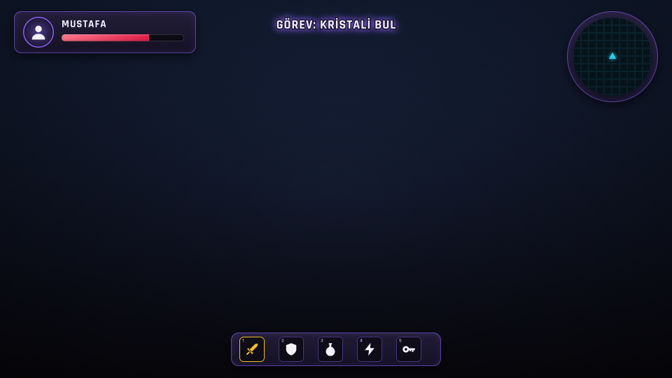
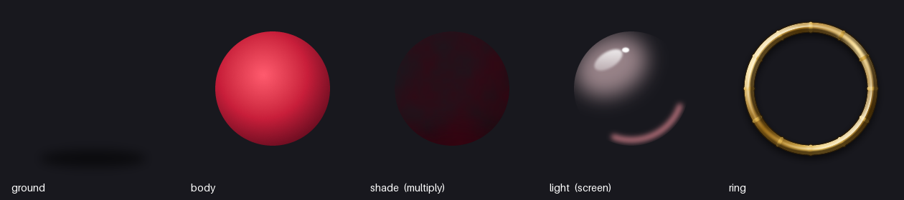
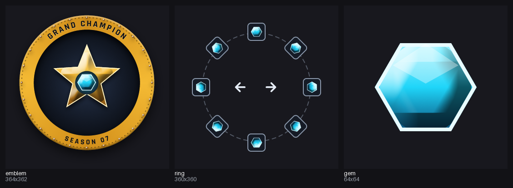

# game-ui-mcp

Claude'un (ya da MCP destekleyen başka bir AI'ın) **oyun ve uygulama arayüzü çizmesini, canlandırmasını ve motora teslim etmesini** sağlayan, tamamen yerel çalışan bir MCP server. MIT lisanslı: ticari dahil herkes özgürce kullanabilir.

İçinde görsel üreten bir AI modeli yok ve internete bağlanmıyor. Hazır bileşen ya da ikon kütüphanesi de yok: "buton", "panel" ya da "ikon" diye bir tool bulunmuyor (ikonları da model `add_path` / `add_svg` ile kendisi çiziyor), yalnızca temel gereçler var (şekil, yazı, stil, keyframe). Ne çıkacağını ve ne kadar iyi olacağını modelin kendi tasarım kararları belirliyor. AI, "dikdörtgen çiz, içine şunu yaz, glow ekle" gibi tool'ları çağırır; server bunları temiz, kenarı yumuşatılmış PNG'ye çevirir, AI kendi çizdiğine bakıp düzeltir ve Unity / Unreal Engine / Roblox Studio için dışa aktarır.




Gerçekçi tarz (yarış, simülasyon, AAA) da çizebiliyor: kadran, ibre, karbon ve metal doku, eğik sekmeler, cam paneller.


Kat kat çalışıyor: taban, gölge, ışık ve detay ayrı katmanlarda kurulur. Solda tek dolguyla çizilmiş hali, sağında aynı şeklin katmanlar ve ışıkla işlenmiş hali:


Kürenin katmanları tek tek (örnek çıktı: [`examples/orb.psd`](examples/orb.psd)):



Bir parçayı bir kez çizip başka canvas'larda canlı kopya olarak kullanabilir (kaynağı değiştirince hepsi değişir), dairesel dizi kurabilir, yazıyı daire üstüne dizebilir, şekilden delik açabilir ve SVG içe aktarabilir. Soldaki amblemde yazılar yay üstünde, perçinler tek elemanın 24'lü dairesel dizisi, yıldızın ortası `erase` ile delinmiş, mücevher başka bir canvas'tan gelen bir instance; ortadaki halkada 8 slot ve 8 mücevher dizi, oklar SVG'den alınıp biri aynalanmış:



Oyun geliştiren ya da uygulama tasarlayan birinin günlük işleri için de araçlar var: bir buton bileşeni ve onun hover / pressed / disabled durumları, tek kart şablonundan veri satırlarıyla üretilen nadirlik kartları, pixel-art modu ve hasar sayıları için hazır pişirilmiş bitmap font:


Aynı HUD'un elemanları ekran kenarlarına sabitlenmiş (pin) halde 16:9, 21:9, 16:10 ve telefonda nasıl durduğu, kırmızı alan cihazın güvenli alan payı:


Animasyon da aynı mantıkla çalışıyor: hazır efekt yok, keyframe ve ease var.

| Buton girişi + parlama | Devir saati | Menü girişi ve seçim |
| --- | --- | --- |
|  |  |  |

Görsellerin tamamı [`examples/demo.py`](examples/demo.py), [`examples/demo_racing.py`](examples/demo_racing.py), [`examples/demo_shading.py`](examples/demo_shading.py), [`examples/demo_components.py`](examples/demo_components.py), [`examples/demo_workflow.py`](examples/demo_workflow.py) ve [`examples/demo_animation.py`](examples/demo_animation.py) içindeki tool çağrılarıyla çizildi. (GIF'ler 256 renkle sınırlı olduğu için gerçek çıktıdan biraz daha kaba görünür.)

## Ne yapabiliyor

- **Şekiller:** dikdörtgen (yuvarlak ya da kesik köşe, eğik), elips, çokgen, yıldız, çizgi (kesikli olabilir), yay, kadran çizgileri, SVG path; konturlarda keskin (miter), yuvarlak ya da pah köşe ve kesikli kontur; `flip_x` / `flip_y` ile aynalama (gölge ve ışık yönü korunur)
- **Yeniden kullanma ve içe aktarma:** `add_instance` (başka canvas'ı canlı bileşen olarak yerleştirir, istenirse animasyonunun belli bir anıyla), `duplicate_element` ile doğrusal ve dairesel dizi (`count`, `rotate`, `pivot`), `add_svg` ile SVG'yi düzenlenebilir path'lere çevirme (logo, hazır ikon setleri)
- **Delik açma:** `blend: "erase"` aynı katmandaki şeyleri keser (pencere, çentik, oyma yazı)
- **Öz denetim:** `review_canvas` kenarda kesilen gölgeyi, düşük yazı kontrastını (WCAG), çok küçük yazıyı, eksik glifi, yarım piksele düşen bulanık kenarları, bozuk katman ve animasyonları bulur; `inspect_pixels` tam renk okur; `view_image` diskteki bir referans görseli gösterir ve renk paletini çıkarır; `fit_canvas` canvas'ı boyanan alana göre daraltır ya da genişletir
- **Katmanlar:** her katmanın kendi opaklığı, karışım modu (multiply, screen, overlay, soft-light, erase... 13 mod) ve stili var; `clip` ile alttaki katmana kırpılır (taşmadan serbest gölge ve ışık boyama); katman stili içindeki her şeyi tek şekil sayar (ortak kontur, ortak gölge)
- **Işık ve gölgeleme:** yönlü ışıkla kabartma (`light`: açı, pah, profil, parlaklık), çoklu ve aralıklı kontur, kademeli gölge, gradient maskeyle söndürme (`mask`), renk düzeltme (`adjust`: parlaklık, kontrast, doygunluk, ton)
- **Stil:** düz renk, linear / radial / conic gradient (isteğe bağlı OKLab geçişi), çizgili / noktalı / ızgara / petek / karbon / fırçalı metal / bulut dokusu, kendi görselinle dolgu, kenar çizgisi (iç, orta, dış), gölge, glow, iç gölge, bevel, bulanıklık, opaklık, bir pivot etrafında döndürme, başka bir şekle kırpma (`clip`)
- **Gösterge:** `add_arc` + `add_ticks` ile devir saati, hız göstergesi, turbo, segmentli LED sıraları; ibre için pivot'lu döndürme
- **Yazı:** 10 gömülü font (Inter, Barlow Condensed, Bebas Neue, Michroma, JetBrains Mono, Rajdhani, Orbitron, Cinzel, Fredoka, Bangers) + bilgisayardaki fontlar, italik, satır kaydırma, genişliğe sığdırma, kontur, daire üstüne dizme (`arc`), Türkçe büyük harf (`uppercase: "tr"`)
- **İkon:** hazır set yok; model 24'lük ızgarada `add_path` ile çizer ya da bir SVG'yi `add_svg` ile alır
- **Ekran ve cihaz:** hazır boyutlar (`preset`: 1080p, 4K, 21:9, Steam Deck, Switch, iPhone, iPad, Android, mobil oyun, TV) ve güvenli alanları; önizlemede güvenli alan, TV kenar payı, ızgara, sütun, üçte bir, baş parmak erişimi kılavuzları; renk körlüğü (protanopi, döteranopi, tritanopi), gri ton ve güneş altında düşük kontrast simülasyonu; HUD'u gerçek bir oyun ekran görüntüsünün üstünde görme
- **Çok çözünürlük:** elemanları kenara sabitleme (`set_pin`: sol / orta / sağ / esnet / oranla), `resize_canvas` ile başka boyuta uyarlama, `preview_resolutions` ile hepsini yan yana görme
- **Etkileşim durumları:** `set_state` ile hover, pressed, disabled, selected, focused (gamepad); önizleme, denetim ve dışa aktarma duruma göre; motor slotları otomatik (Unity SpriteState, Godot TextureButton, Roblox HoverImage / PressedImage)
- **Veri ve şablon:** yazıda `{yer_tutucu}`, canvas'a özel renk token'ları, `generate_from_template` ile tek şablondan onlarca kart / rozet / seviye ikonu; bileşen kopyalarına ayrı yazı, renk ve durum
- **Yerelleştirme:** `set_strings` ile dil tabloları, her yerde `language`, 35% uzatıp aksanlayan `pseudo` dili ve taşan yazıyı bulan denetim
- **Yerleşim ve üretim:** satır / sütun / ızgara yerleşimi ve içeriğe göre büyüyen kutu (`arrange_elements`), tohumlu rastgele dağıtma (`scatter`: kıvılcım, konfeti, yıldız; istenirse senkronsuz parıldama animasyonu), animasyonda sırayla gecikme (`stagger`), canvas'lar arası kopyalama, redo
- **Pixel art:** kenar yumuşatmasız çizim, palet ya da renk sayısı sınırı, büyütmede tam piksel
- **Teslim:** 9-slice germe testi, geliştirici spec'i (ölçülü görsel + JSON), tema token'ları (CSS, Unity USS, C#, GDScript, Luau, JSON), tıklanabilir HTML prototip (ekranlar arası geçiş, hover / basılı hal), ekranı motor sahnesine çevirme (Godot `.tscn`, Roblox LocalScript, Unity UXML + USS; yazılar gerçek yazı olarak kalır), bitmap font (BMFont `.fnt`), uygulama ikonu (ICO, boyut seti), PNG / WebP / JPG
- **Animasyon:** keyframe + ease ile her özellik canlandırılır (konum, ölçek, dönme, opaklık, renk, efekt, yay açısı, yazı); film şeridi önizlemesi; sprite sheet, kare dizisi, GIF / APNG / WebP ya da motorun kendi tween'i için keyframe JSON çıktısı
- **Tema:** renk token'ları (`$primary`) ve isimli stiller; bütün kit tutarlı kalır
- **Önizleme:** AI çizdiğini resim olarak geri görür (yakınlaştırma, eleman kutuları, oyun sahnesi arka planı)
- **Dışa aktarma:** PNG (1x, 2x), otomatik 9-slice, atlas, katman katman PNG + yerleşim JSON'u, düzenlenebilir katmanlı PSD, Unity / Unreal / Roblox / Godot için hazır değerler ve yardımcı dosyalar

## Kurulum (Windows)

Python 3.10 ya da üstü gerekli.

```powershell
git clone https://github.com/TENETTE/game-ui-mcp
cd game-ui-mcp
python -m venv .venv
.venv\Scripts\pip install -e .
```

Deneme (örnek görselleri yeniden üretir):

```powershell
.venv\Scripts\python examples\demo.py
.venv\Scripts\python examples\demo_racing.py
.venv\Scripts\python examples\demo_shading.py
.venv\Scripts\python examples\demo_animation.py
```

### Claude Desktop'a bağlama

`claude_desktop_config.json` dosyasına ekle (Windows'ta `%APPDATA%\Claude\` klasöründe; uygulamada Ayarlar → Developer → Edit Config ile de açılır, menü adı sürüme göre değişebilir):

```json
{
  "mcpServers": {
    "game-ui": {
      "command": "C:\\Users\\SEN\\game-ui-mcp\\.venv\\Scripts\\python.exe",
      "args": ["-m", "game_ui_mcp"]
    }
  }
}
```

Yolu kendi klasörüne göre değiştir, Claude Desktop'ı tamamen kapatıp aç.

### Claude Code'a bağlama

```powershell
claude mcp add game-ui -- C:\Users\SEN\game-ui-mcp\.venv\Scripts\python.exe -m game_ui_mcp
```

### Skill

`skill/game-ui-mcp/SKILL.md`, Claude'a bu tool'ları iyi kullanmayı öğretir (tema kurma, katman sırası, 9-slice kuralları, kontrol turu, motor tarafı). Claude'da skill olarak ekle; Claude Code kullanıyorsan klasörü `.claude/skills/` altına kopyala.

## Dosyalar nereye gidiyor

Varsayılan çalışma klasörü `C:\Users\SEN\GameUI`:

| Klasör | İçerik |
| --- | --- |
| `projects/` | Canvas'lar (JSON). Oturum kapansa da kalır. |
| `exports/` | Yol verilmeden yapılan dışa aktarmalar |
| `fonts/` | Buraya attığın `.ttf` / `.otf` dosyaları font listesine girer |
| `theme.json` | Renk token'ları ve stiller |
| `strings.json` | Dil tabloları (`set_strings`) |

Başka bir klasör için `GAME_UI_MCP_DIR` ortam değişkenini ayarla (config'te `"env": {"GAME_UI_MCP_DIR": "D:\\UI"}`).

## Tool'lar

| Grup | Tool'lar |
| --- | --- |
| Canvas | `create_canvas`, `list_canvases`, `get_canvas`, `update_canvas`, `duplicate_canvas`, `delete_canvas`, `fit_canvas`, `resize_canvas` |
| Katman | `create_layer`, `update_layer`, `delete_layer`, `set_layer` |
| Çizim | `add_rect`, `add_ellipse`, `add_line`, `add_polygon`, `add_path`, `add_arc`, `add_ticks`, `add_text`, `add_image`, `add_instance`, `add_svg` |
| Düzenleme | `update_element`, `delete_elements`, `duplicate_element`, `move_elements`, `reorder_element`, `align_elements`, `arrange_elements`, `scatter`, `copy_elements`, `set_pin`, `batch`, `undo`, `redo` |
| Durum, veri, dil | `set_state`, `delete_state`, `generate_from_template`, `set_strings`, `get_strings` |
| Denetim | `review_canvas`, `inspect_pixels`, `view_image`, `preview_nine_slice` |
| Animasyon | `create_animation`, `set_keyframes`, `delete_keyframes`, `get_animations`, `delete_animation`, `preview_animation`, `export_animation` |
| Tema ve bilgi | `set_theme`, `get_theme`, `list_fonts`, `measure_text` |
| Önizleme | `preview`, `preview_resolutions`, `contact_sheet` |
| Dışa aktarma | `export_png`, `export_asset`, `export_layers`, `export_psd`, `export_atlas`, `export_bitmap_font`, `write_engine_helpers` |
| Teslim | `export_spec`, `export_theme`, `set_link`, `export_prototype`, `export_screen` |

Stil nesnesi kısaca:

```json
{
  "fill": {"type": "linear", "angle": 90, "stops": [[0, "#a78bfa"], [1, "#5b21b6"]]},
  "stroke": {"color": "$primary@0.6", "width": 2, "align": "inside", "join": "miter", "dash": [8, 4]},
  "shadow": {"color": "#000000@0.5", "blur": 12, "dy": 6},
  "glow": {"color": "$accent", "blur": 16},
  "inner_shadow": {"color": "#000@0.6", "blur": 8, "dy": 2},
  "bevel": {"size": 2},
  "opacity": 1.0
}
```

Renkler: `#rrggbb`, `#rrggbbaa`, `rgba(...)`, `hsl(...)`, CSS renk adları (`gold`, `crimson`...), `$token`; sonuna `@0.5` eklenince alfa olur.

Açılar (yay, kadran çizgisi, conic gradient): derece, 0 = saat 3 yönü, saat yönünde artar. Klasik bir gösterge 135'ten 405'e süpürür.

## Katmanlar

Canvas, alttan üste dizilen katmanlardan oluşur. `create_layer` yeni katmanı aktif yapar; sonraki elemanlar ona gider. Katman oluşturulmadan çizilenler en alttaki örtük `base` katmanında kalır.

```json
[{"op": "create_layer", "name": "body"},
 {"op": "add_ellipse", "cx": 120, "cy": 116, "rx": 80, "fill": "#c81e3a"},
 {"op": "create_layer", "name": "shade", "clip": true, "blend": "multiply"},
 {"op": "add_ellipse", "cx": 120, "cy": 196, "rx": 70, "ry": 26, "fill": "#2a0410@0.7", "style": {"blur": 22}},
 {"op": "create_layer", "name": "ring", "style": {"light": {"angle": 225, "size": 5, "gloss": 0.8}}}]
```

- `clip: true`: katman yalnızca altındaki katmanın pikselleri üstünde görünür. Gölge ve ışık şekilleri tabandan taşmaz.
- `style`: katmanın birleşik görüntüsüne uygulanır (kontur, gölge, glow, `light`, bulanıklık, `adjust`, `mask`).
- `export_layers` her katmanı ayrı PNG olarak verir (clip'li katmanlar varsayılan olarak tabanına gömülür); `export_psd` yığını Photoshop, Photopea, Krita ve GIMP'te açılan katmanlı dosya olarak kaydeder.

## Animasyon

Bir animasyon, canvas'a bağlı bir keyframe kümesidir. Her iz (track) bir elemanın ya da bir grubun tek bir özelliğini zaman içinde değiştirir:

```json
{"animation": "appear", "target": "group:btn", "property": "scale", "pivot": [180, 64],
 "keyframes": [[0, 0.55], [0.28, 1, "back-out"]]}
```

- **Özellikler:** yardımcılar `dx`, `dy`, `scale`, `scale_x`, `scale_y`, `opacity`; her sayısal eleman özelliği (`x`, `width`, `rotation`, `end_angle`, `dash_offset`, ...); stil yolları (`style.glow.blur`, `style.fill`, `style.stroke.color`); adım adım değişenler (`text`, `visible`).
- **Ease:** `linear`, `step`, `ease-in/out/in-out` ve stil + yön: `sine`, `quad`, `cubic`, `quart`, `quint`, `expo`, `circ`, `back`, `elastic`, `bounce` × `in`, `out`, `in-out` (ör. `back-out`); ya da cubic-bezier `[x1, y1, x2, y2]`. Bir keyframe'deki ease o keyframe'e varışı şekillendirir.
- **Önizleme:** `preview_animation` animasyonu zaman etiketli kareler halinde yan yana gösterir; model hareketi buradan okur.
- **Çıktı (`export_animation`):** `json` (motorun kendi tween'i için; ease'lerin Roblox TweenService ve DOTween adlarıyla), `spritesheet`, `frames`, `gif`, `apng`, `webp`.

## Motorlara aktarma

`export_asset` PNG'nin yanına `<ad>.gameui.json` yazar ve klasördeki `game_ui_manifest.json` dosyasını günceller. `nine_slice: "auto"` esneyecek orta bölgeyi kendisi bulur ve dokuyu küçültür.

| Motor | 9-slice değeri | Yardımcı (`write_engine_helpers`) |
| --- | --- | --- |
| Unity | Sprite border (L, B, R, T) | `GameUiImporter.cs`: yanında `.gameui.json` olan her PNG'yi UI sprite olarak ayarlar |
| Unreal | Brush `Draw As: Box`, Margin (L, T, R, B, 0-1) | `import_game_ui.py`: texture'ları UI ayarlarıyla içe aktarır, margin'leri log'a yazar |
| Roblox | `SliceCenter`, `SliceScale` | `GameUiAssets.luau`: `GameUi.apply(imageLabel, "ad")` |
| Godot 4 | `NinePatchRect` patch margin / `StyleBoxTexture` texture margin (L, T, R, B px) | her 9-slice asset için `<ad>.stylebox.tres` |

**Bütün bir ekran** için `export_screen`: her `group` bir görsel parça olur, yazılar motorun kendi yazısı olarak kalır (çevrilebilir, keskin), `set_pin` ile verilen sabitlemeler motorun anchor'larına çevrilir. Godot'ta `.tscn` sahnesi (TextureRect / NinePatchRect / Label), Roblox'ta ScreenGui kuran LocalScript (ekran yüksekliğine göre ölçeklenir), Unity'de UI Toolkit `.uxml` + `.uss` üretir; kullanılan fontlar yanına kopyalanır.

Hareketli parçalar (ibre, dolan yay) için `export_layers`: her `group` ayrı PNG olur, `<ad>.layout.json` her parçanın konumunu ve dönme merkezini verir. Assetto Corsa (CSP Lua) gibi PNG kullanan her ortamda bu çıktılar doğrudan kullanılabilir.

Roblox'ta görselleri Studio'ya kendin yüklemen gerekir (server internete çıkmaz); asset id'lerini sonra `write_engine_helpers(roblox_ids=...)` ile işlersin.

## Sınırlar

- Karakter portresi, illüstrasyon, fotoğraf gibi şeyleri üretmez. Bunlar için hazır bir görseli `add_image` ile yerleştirebilirsin.
- Katman stilindeki kontur (`create_layer(style={"stroke":...})`) köşelerde her zaman yuvarlaktır; keskin köşe için konturu elemana ver.
- `add_svg` metin, filtre, maske, `<use>` ve CSS sınıflarını almaz (atladıklarını `notes` ile söyler); `gradientTransform` yok sayılır.
- Instance'lar iç içe en fazla 6 seviye olabilir; bir canvas kendini (dolaylı da olsa) içeremez.
- Arka planı bulanıklaştıran gerçek "buzlu cam" PNG'ye gömülemez; o efekt motor tarafında yapılır (Unreal'da `BackgroundBlur`). Burada camın koyu, yarı saydam hali çizilir.
- PSD'de katman adı, opaklık, karışım modu, görünürlük ve clip korunur; katman stilleri ve katmandaki elemanlar piksele gömülür (vektör ya da canlı efekt olarak kalmaz). `erase` modundaki bir katman PSD'de karşılığı olmadığı için gizli katman olarak kaydedilir. Dosya sıkıştırılmadan yazılır, büyük canvas'larda boyut büyür.
- Motorlar multiply / screen gibi karışım modlarını düz görselle uygulayamaz; bu yüzden clip'li gölge ve ışık katmanları dışa aktarılırken tabana gömülür.
- Animasyon çıktısı veri ve görseldir; motor içinde oynatan kodu (TweenService, DOTween, UMG) model yazar. Büyük canvas'larda kare kare çıktı yavaştır (1920×1080 ve 80 eleman için kare başına yaklaşık 1 sn).
- Yazıda harf aralığı verilince kerning uygulanmaz.
- Orbitron fontunda Ğ / ğ yok; tool böyle durumlarda uyarı döndürür.
- Motor tarafındaki dosyalar (C#, Unreal Python, Luau, Godot `.tres` / `.tscn`, Unity UXML / USS) bu repoda yalnızca üretiliyor ve biçimleri kontrol ediliyor; Unity, Unreal, Roblox Studio ve Godot içinde henüz açılıp denenmedi. Tıklanabilir prototip ise gerçek bir tarayıcıda (headless Chrome) denendi.
- `export_screen` Unreal için sahne üretmez (UMG dosyası dışarıdan yazılamıyor); Unreal'da parçalar + `.screen.json` kullanılır. Roblox'ta özel font yüklenemediği için yazılar en yakın hazır Roblox fontuyla eşleştirilir. Gradient'li yazı motora ilk rengiyle gider (`bake_text` ile görsel olarak gömülebilir).
- Pixel-art modu yazıyı da keskinleştirir ama gömülü fontlar piksel font değildir; gerçek piksel yazı için `fonts/` klasörüne bir piksel font koy.
- 71 tool var; MCP istemcisi hepsinin tanımını modele yükler (yaklaşık 23 bin token).

## Lisans

[MIT](LICENSE): kullan, değiştir, sat, kendi oyununa ya da ürününe koy; tek şart lisans metnini kopyalarda tutmak. Gömülü fontlar kendi lisanslarıyla (SIL Open Font License) gelir. Bu araçla çizdiğin görseller senindir.

## Geliştirme

```powershell
.venv\Scripts\pip install -e ".[dev]"
.venv\Scripts\python -m pytest
```

Çizim motoru Pillow + numpy üzerine kurulu: şekiller 4 kat çözünürlükte piksel merkezine göre taranır, sonra küçültülür; efektler çıkış çözünürlüğünde uygulanır. MCP Python SDK'nın 1.x ve 2.x sürümleriyle çalışır.

## Fontlar

`src/game_ui_mcp/assets/fonts/` altındaki fontlar SIL Open Font License ile dağıtılır; her klasörde `OFL.txt` bulunur.
