<div align="center">

[English](README.md) · **Türkçe**

# game-ui-mcp

### Oyun ve uygulama arayüzünü tasarlamak, canlandırmak ve teslim etmek için tek MCP.

**Ekranı anlat. Motora hazır görseli, animasyonu ve kodu al.**

[](https://github.com/TENETTE/game-ui-mcp/actions/workflows/tests.yml)
[](#toollar)
[](#hızlı-başlangıç)
[](#hızlı-başlangıç)
[](LICENSE)

[Hızlı başlangıç](#hızlı-başlangıç) · [Nasıl çalışır](#nasıl-çalışır) · [Neye çıktı verir](#neye-çıktı-verir) · [Örnekler](#örnekler) · [Özellikler](#özellikler) · [SSS](#sss) · [Belgeler](#belgeler)

<code>claude mcp add game-ui -s user -- uvx --from git+https://github.com/TENETTE/game-ui-mcp game-ui-mcp</code>

<br /><br />

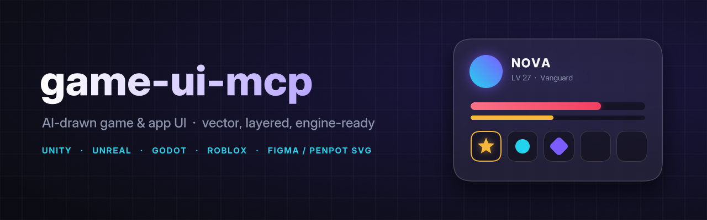

</div>

---

Menü, HUD, can barı ya da koca bir ayarlar ekranı mı lazım? AI ajanına söyle. game-ui-mcp ona bir tasarım programının gereçlerini verir: şekil, yazı, katman, ışık, materyal, otomatik yerleşim, bileşen ve keyframe animasyon. Ajan çizer, sonuca bakar, kendi hatalarını bulur ve düzeltir.

Tasarım tamamlanınca aynı canvas neye ihtiyacın varsa ona dönüşür: Unity, Unreal, Godot ve Roblox için 9-slice sprite ve sahne, düzenlenebilir SVG ve PSD, PDF, Lottie, MP4, çalışan bir web sitesi ya da etkileşimleriyle React bileşenleri.

Her şey bilgisayarında çalışır. Görsel üreten bir model yok, internete çıkmaz: her piksel ajanın çağırdığı tool'lardan gelir. Sonuç temiz, tekrarlanabilir ve düzenlenebilir.

## Hızlı başlangıç

### Ajanına kur

[uv](https://docs.astral.sh/uv/) kurulu olsun (`winget install astral-sh.uv`, `brew install uv` ya da `pip install uv`). İlk açılışta kendini indirir (yaklaşık 30 saniye).

**Claude Code**

```bash
claude mcp add game-ui -s user -- uvx --from git+https://github.com/TENETTE/game-ui-mcp game-ui-mcp
```

**Claude Desktop, Cursor, Windsurf ve diğer MCP istemcileri** (VS Code'da `.vscode/mcp.json` içinde anahtar `mcpServers` yerine `servers`):

```json
{
  "mcpServers": {
    "game-ui": {
      "command": "uvx",
      "args": ["--from", "git+https://github.com/TENETTE/game-ui-mcp", "game-ui-mcp"]
    }
  }
}
```

Claude Desktop'ta dosya: Ayarlar → Developer → Edit Config. Kaydettikten sonra istemciyi tamamen kapatıp aç.

<details>
<summary>GPU sürümü, video çıktısı ve skill</summary>

**GPU.** NVIDIA ekran kartın varsa `[gpu]` sürümü shader dolgularını, materyalleri ve büyük bulanıklıkları ekran kartında hesaplar (CuPy + CUDA 12, yaklaşık 1 GB indirir; RTX 4060 Ti'de 9-11 kat hızlı). CUDA açılamazsa aynı sonuçla CPU'ya döner. Kapatmak için `GAME_UI_MCP_GPU=0`.

```bash
claude mcp add game-ui -s user -- uvx --from "game-ui-mcp[gpu] @ git+https://github.com/TENETTE/game-ui-mcp" game-ui-mcp
```

**Video.** MP4 / WebM çıktısı PATH'teki `ffmpeg`'i kullanır (`winget install ffmpeg`, `brew install ffmpeg`); yoksa `[video]` eki bir tane kurar.

**Skill.** [`skill/game-ui-mcp/SKILL.md`](skill/game-ui-mcp/SKILL.md) ajana işin inceliklerini öğretir: tema, katman sırası, ışık, 9-slice kuralları, animasyon zamanlaması, etkileşim, kontrol turu ve motora teslim. Claude Code'da klasörü `~/.claude/skills/` altına kopyala. Claude uygulamalarında klasörü zip'leyip Ayarlar → Capabilities → Skills bölümünden yükle.

</details>

### Ajanına sor

```text
Bilim kurgu oyunu için bir ana menü tasarla: başlık, hover ve basılma durumları
olan dört buton, bir ayarlar penceresi. Kontrol et, sonra tıklanabilir bir web
sitesi ve Unity için 9-slice sprite olarak ver.
```

Başka fikirler:

- "Yarış oyunu için devir saati çiz, ibresi dönsün, parçaları ayrı katman olarak `D:\Oyun\UI` klasörüne ver."
- "Bu zafer ekranı için üç farklı yön göster, sonra ikincisiyle devam et."
- "Taş ve deri materyalli, altın kenarlı bir envanter paneli yap."
- "Bu menüyü Arapça ve Japoncaya çevir, taşan yazı var mı kontrol et."
- "Bu kart animasyonunu mağaza sayfası için MP4 yap."
- "Temayı kodlama ajanım için DESIGN.md olarak ver."

### Güncelle

`uvx` bir kopyayı önbellekte tutar. En yeni sürüm için önbelleği temizle ve istemciyi yeniden başlat:

```bash
uv cache clean game-ui-mcp
```

## Nasıl çalışır

Ajan tool'ları MCP üzerinden çağırır. Server canvas'ları tutar, çizer ve bir resimle cevap verir; ajan böylece çizdiğine bakabilir. `review_canvas` yazılı bir denetim ekler (kesilen gölge, düşük kontrast, taşan yazı, eksik harf, yarım piksel bulanıklığı, tutarsız köşe yarıçapları). Ajan bulduklarını düzeltir, sonra dışa aktarır.

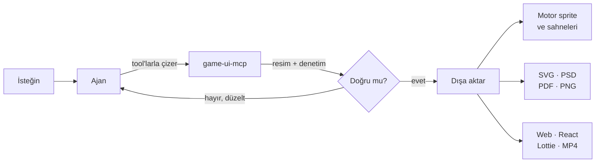

## Neye çıktı verir

| Hedef | Ne alırsın | Tool'lar |
| --- | --- | --- |
| Unity | İçe aktarma yardımcılı 9-slice sprite, UI Toolkit ekranı (UXML + USS), C# token'ları | `export_asset`, `export_screen`, `write_engine_helpers` |
| Unreal | Margin'li Box brush, editör içe aktarma betiği | `export_asset`, `write_engine_helpers` |
| Godot 4 | `.tscn` sahne, `StyleBoxTexture` kaynakları, GDScript token'ları | `export_screen`, `export_asset` |
| Roblox | LocalScript ekranı, slice merkezleri, Luau token'ları | `export_screen`, `export_asset` |
| Hareketli parçalar | Pivot'lu ayrı katmanlar, sprite sheet, Roblox ve DOTween ease adlı tween JSON'u | `export_layers`, `export_animation` |
| Web sitesi | Gerçek yazılı, linkli, üst pencereli, hover'lı, animasyonlu ve etkileşimli HTML / CSS | `export_web` |
| React | Her ekran için JSX + CSS bileşeni, görseller import edilir, etkileşimler dahil | `export_react` |
| Mobil ve masaüstü uygulama | iOS / Android / web boyut setleri, uygulama ikonu, ICO | `export_png` |
| Tasarım programları | Düzenlenebilir vektör SVG, katmanlı PSD | `export_svg`, `export_psd` |
| Baskı ve sunum | Çok sayfalı vektör PDF | `export_pdf` |
| Uygulamalar ve oynatıcılar | Vektör katmanlı Lottie | `export_animation` |
| Video | MP4 (H.264) ya da saydam WebM | `export_animation` |
| Geliştiriciler ve ajanlar | Ölçü dökümü, token'lar (CSS, USS, DTCG, C#, GDScript, Luau), DESIGN.md | `export_spec`, `export_theme` |

## Örnekler

Buradaki her resmi server kendisi çizdi; [`examples/`](examples) içindeki betikler hepsini yeniden üretir.

### Bütün bir UI kiti

Tek temadan buton, panel, bar, slot ve rozetler; `contact_sheet` ile yan yana kontrol.

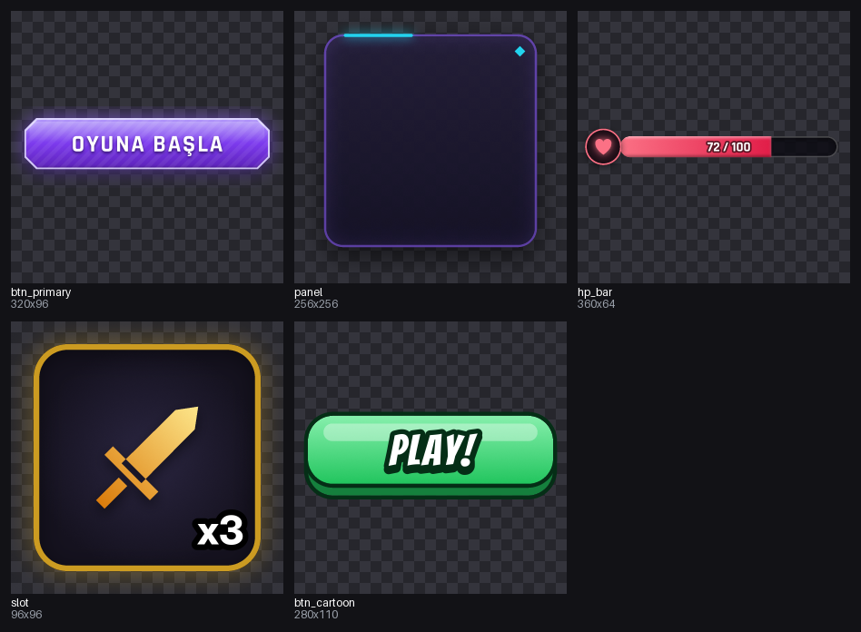

### Gerçekçi yarış HUD'u

Koyu cam paneller, karbon ve fırçalı metal, çentikli devir saati, ibre ve LED sırası, sabit genişlikli rakamlarla telemetri.

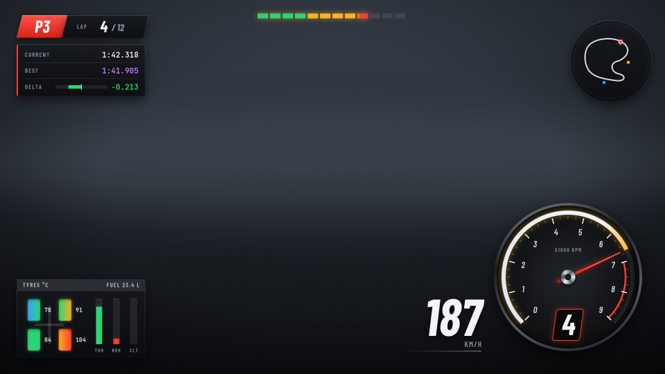

### Materyaller

23 prosedürel materyal; rengi, deseni ve hareketi ayarlanabilir. Temada kendi materyalini de tanımlarsın: hazır birinden türeterek ya da sıfırdan shader formülüyle.

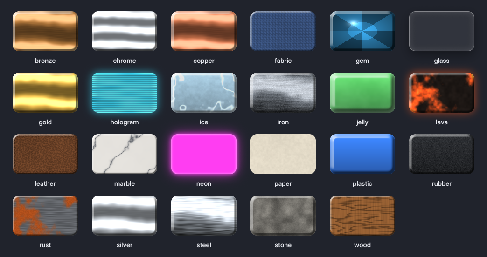

### Tasarım varyasyonları

`make_variations` tek çağrıda palet, şekil ve yazı yönlerini dener ve orijinalin yanına dizer.

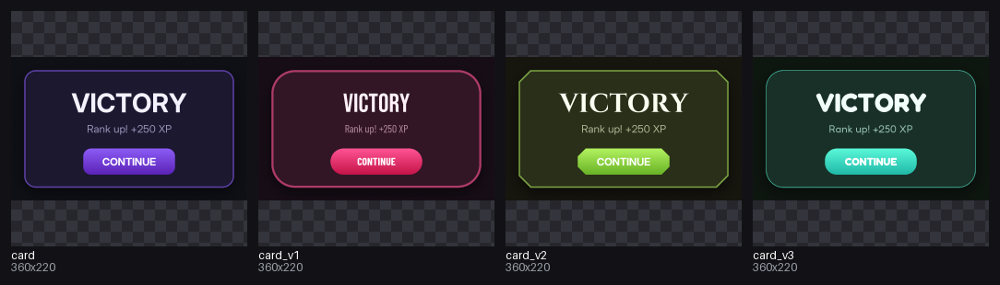

### Tek ekranda tasarım araçları

Boolean şekiller, yumuşatılmış köşe, dolgu yığını, satır atlayan yerleşim, buzlu cam, tek kenar kontur, kırpılan yazı ve açık / koyu mod; aynı ekran [düzenlenebilir SVG](examples/design_tools.svg) olarak da çıkıyor.

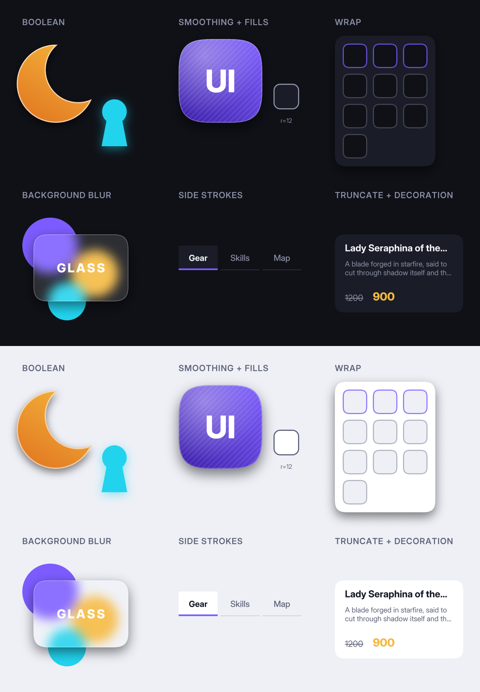

### Animasyon

| Buton girişi + parlama | Devir saati | Menü girişi ve seçim |
| --- | --- | --- |
| 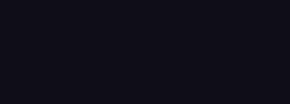 | 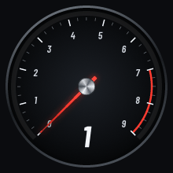 | 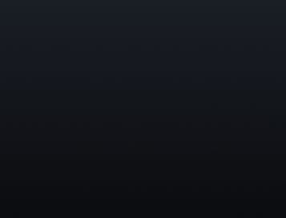 |

<details>
<summary>Daha fazla örnek</summary>

**Işık ve gölgeleme.** Düz şekillerden katman, kırpma ve yönlü ışıkla cam, metal ve plastik.

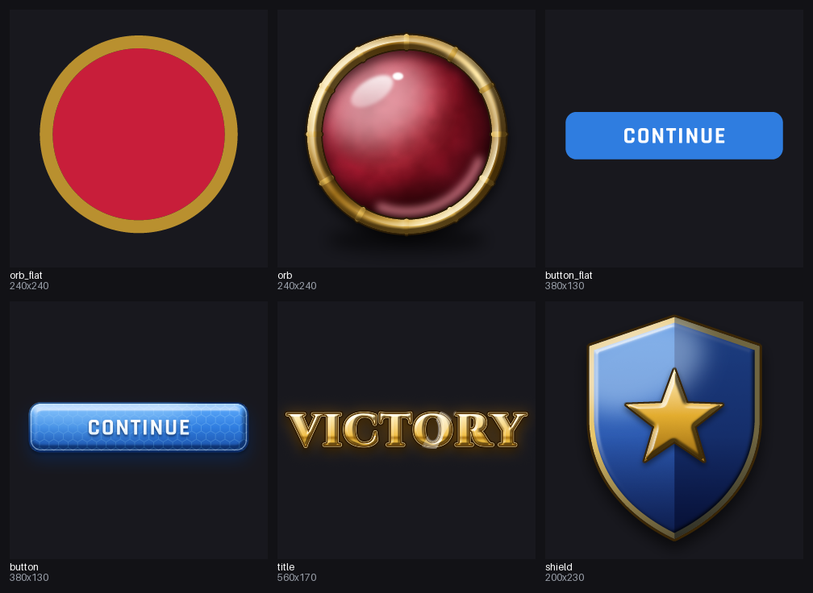

**Kat kat boyama.** Zemin gölgesi, gövde, gölge (multiply), ışık (screen) ve halka; her biri ayrı katmanda.

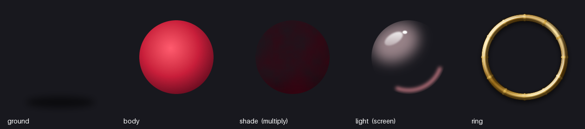

**Gerçekçi kit.** Karbon, cam, torna metal ve turbo göstergesi.

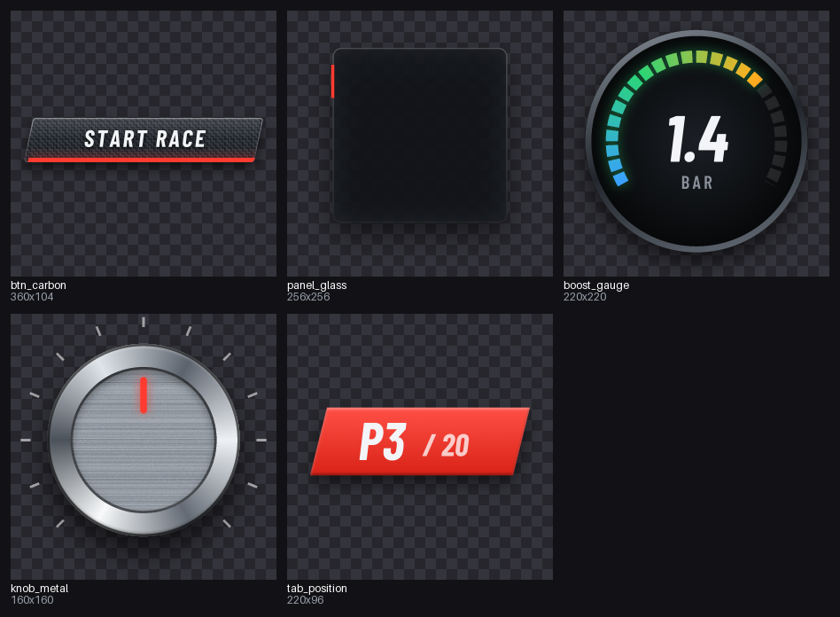

**Bileşen, durum ve veri.** Dört durumlu tek buton, veri satırlarından üretilen eşya kartları, piksel sanat modu.

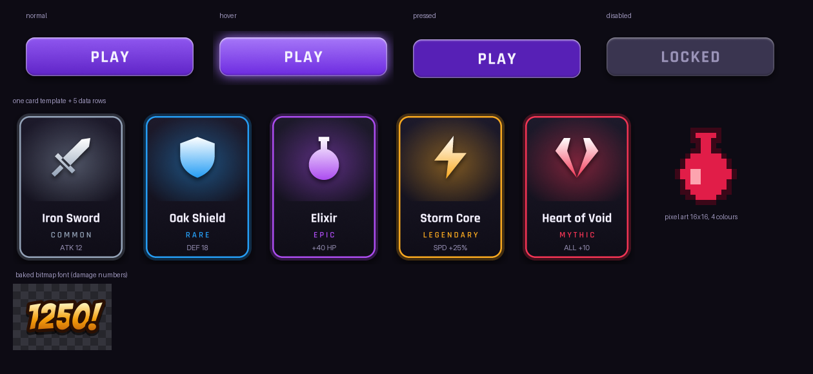

**Çoklu çözünürlük.** Ekran kenarlarına sabitlenmiş tek HUD; 16:9, 21:9 ve telefon boyutlarında kontrol.

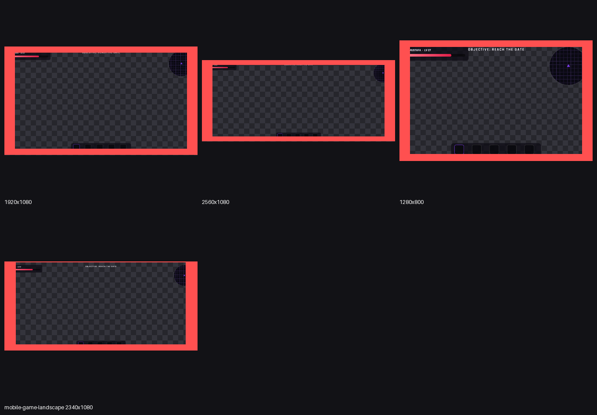

</details>

## Özellikler

- **Şekiller:** yuvarlak, kesik ya da yumuşatılmış köşeli dikdörtgen, elips, çokgen ve yıldız, ok uçlu ve incelen çizgiler, yay, gösterge çentikleri, SVG path ve içe aktarma, kesin boolean, offset / kontur / düzleştirme, bileşenler, doğrusal ve dairesel diziler, görseli vektöre çevirme.
- **Stil:** düz renk, doğrusal / radyal / konik / elmas gradient (OKLab), desenler, dolgu yığını, kendi piksel formüllerin (shader), 23 hazır + kendi materyallerin, çoklu kontur, gölge, glow, iç efektler, bevel, yönlü 3B ışık, buzlu ve kıran cam, kademeli bulanıklık, yumuşak kenar, gren, kenar dokusu, maske, 13 karışım modu, kırpmalı katmanlar.
- **Görseller:** kırpma, arka plan silme, herhangi bir şeklin içinde kaydırma ve yakınlaştırma, animasyonlu GIF / APNG / WebP ve sprite sheet, alt-piksel akıcı hareket.
- **Yazı:** 10 gömülü font ve sistem fontları; Arapça, İbranice, Hint yazıları, Tayca ve CJK HarfBuzz ile şekillendirilir; renkli emoji, OpenType özellikleri, değişken eksenler, liste, yay ve yol üstünde yazı, kırpma, yazıyı şekle çevirme, eksik harf kontrolü.
- **Tasarım sistemi:** renk ve sayı token'ları, açık / koyu / takım modları, isimli stiller, kontrast kontrollü palet üretimi, W3C DTCG ve DESIGN.md içe / dışa aktarma, kit genelinde stil değiştirme, sürüm geçmişi.
- **Yerleşim:** canlı otomatik yerleşim (satır / sütun / ızgara, satır atlama, içeriğe sarma, doldurma, en az / en fazla, hücre yayılımı), ekran kenarına sabitleme, güvenli alanlı cihaz hazırları, çoklu çözünürlük önizleme, renk körlüğü simülasyonu.
- **Bileşen ve veri:** kopyalar, varyantlar, slotlar, isteğe bağlı parçalar, etkileşim durumları, veri satırlarından şablon, sahte yerelleştirmeli dil tabloları.
- **Animasyon:** her özellikte keyframe, spring dahil 30'dan fazla ease, yol boyunca hareket, sıralı giriş, hareket bulanıklığı, film şeridi önizleme.
- **Etkileşim:** web ve React çıktısında çalışan, motor kodu için de listelenen bir durum makinesi (hover, basma, tıklama, tuş, animasyon zinciri, durumlar, gezinme).
- **Denetim:** bölge ve yakınlaştırmalı `preview`, `review_canvas` denetimi, piksel inceleme, karşılaştırma sayfası, tasarım varyasyonları.

Stil anahtarları, katmanlar, animasyon ve motor tablolarıyla tam referans: **[docs/GUIDE.md](docs/GUIDE.md)**.

## Tool'lar

<details>
<summary><strong>85 tool'un hepsi</strong></summary>

| Grup | Tool'lar |
| --- | --- |
| Canvas | `create_canvas`, `list_canvases`, `get_canvas`, `update_canvas`, `duplicate_canvas`, `delete_canvas`, `fit_canvas`, `resize_canvas`, `canvas_version` |
| Katmanlar | `create_layer`, `update_layer`, `delete_layer`, `set_layer` |
| Çizim | `add_rect`, `add_ellipse`, `add_line`, `add_polygon`, `add_path`, `add_arc`, `add_ticks`, `add_text`, `add_image`, `add_instance`, `add_svg` |
| Düzenleme | `update_element`, `delete_elements`, `duplicate_element`, `boolean_elements`, `path_ops`, `restyle`, `find_elements`, `vectorize_image`, `move_elements`, `reorder_element`, `align_elements`, `arrange_elements`, `scatter`, `copy_elements`, `set_pin`, `batch`, `undo`, `redo` |
| Durum, veri, dil | `set_state`, `delete_state`, `generate_from_template`, `set_strings`, `get_strings` |
| Denetim | `review_canvas`, `inspect_pixels`, `view_image`, `preview_nine_slice` |
| Animasyon | `create_animation`, `set_keyframes`, `delete_keyframes`, `get_animations`, `delete_animation`, `preview_animation`, `export_animation` |
| Tema ve bilgi | `set_theme`, `get_theme`, `make_palette`, `list_fonts`, `measure_text`, `guide` |
| Önizleme ve keşif | `preview`, `preview_resolutions`, `contact_sheet`, `make_variations` |
| Dışa aktarma | `export_png`, `export_svg`, `export_pdf`, `export_web`, `export_react`, `export_asset`, `export_layers`, `export_psd`, `export_atlas`, `export_bitmap_font`, `write_engine_helpers` |
| Teslim | `export_spec`, `export_theme`, `set_link`, `set_interaction`, `export_prototype`, `export_screen` |

Bakmaya yarayan tool'lar (`preview`, `get_*`, `review_canvas`...) salt okunur, `delete_*` ise yıkıcı olarak işaretli; istemciler buna göre atlar ya da onay sorar. Her hata ajana neyin yanlış olduğunu ve nasıl düzeleceğini söyler.

</details>

## SSS

<details>
<summary><strong>Hangi ajanlar kullanabilir?</strong></summary>

Yerel MCP server destekleyen her istemci: Claude Code, Claude Desktop, Cursor, Windsurf, VS Code ve diğerleri. Bkz. [Hızlı başlangıç](#hızlı-başlangıç).

</details>

<details>
<summary><strong>Görsel üreten bir model ya da internet kullanıyor mu?</strong></summary>

Hayır. Ajan her şeyi şekil, yazı ve efektlerden kurar, server bilgisayarında çizer. Hiçbir şey yüklenmez; tool sonuçlarını ajanın model sağlayıcısı kendi veri politikasıyla görür.

</details>

<details>
<summary><strong>Karakter, illüstrasyon ya da fotoğraf çizer mi?</strong></summary>

Hayır, işi bu değil; arayüz çizer. Hazır görseli `add_image` ile yerleştir: kırpar, düz arka planı siler, kaydırır, yakınlaştırır ya da animasyon olarak oynatır.

</details>

<details>
<summary><strong>Dosyalarım nerede?</strong></summary>

Canvas'lar, tema ve çıktılar `~/GameUI` klasöründe durur, yeniden başlatınca da kalır. Başka klasör için istemci config'ine `"env": {"GAME_UI_MCP_DIR": "D:\\UI"}` ekle. `~/GameUI/fonts/` içine bırakılan fontlar kullanılabilir olur.

</details>

<details>
<summary><strong>Motor dosyaları motorların içinde denendi mi?</strong></summary>

Üretiliyor ve biçimleri test ediliyor, ama henüz Unity, Unreal, Godot ya da Roblox içinde açılmadı. İçe aktarma hata verirse mesaj genelde ajana neyi değiştireceğini söyler; yine de lütfen [issue aç](https://github.com/TENETTE/game-ui-mcp/issues).

</details>

<details>
<summary><strong>Tool'lar ne kadar bağlam kaplıyor?</strong></summary>

85 tool tanımı yaklaşık 30 bin token. Tool'ları gerektikçe yükleyen istemciler (Claude Code) çok daha azını öder. Uzun referanslar server talimatlarında değil, `guide` tool'unun arkasında durur.

</details>

<details>
<summary><strong>Hata bulursam ne yapayım?</strong></summary>

Önce [güncelle](#güncelle). Sürerse ne istediğini, tool çağrısını ve hata mesajını yazarak [issue aç](https://github.com/TENETTE/game-ui-mcp/issues).

</details>

## Belgeler

- [Rehber](docs/GUIDE.md): her özellik, stil anahtarı, katman kuralı, animasyon ve motor tablosu, sınırlar.
- [Skill](skill/game-ui-mcp/SKILL.md): ajanın izlediği iş akışı ve tasarım kuralları.
- [Değişiklik günlüğü](CHANGELOG.md): her sürümde ne değişti.
- Ajanın içinde `guide(topic)` dolgular, shader, stil, tasarım, katmanlar, geometri, yazı, yeniden kullanım, denetim, animasyon ve çıktı için tam referansı verir.

## Güvenlik

- İnternete çıkmaz. Üretilen motor betikleri yazılır, asla çalıştırılmaz. Shader formülleri dosyaya ya da sisteme dokunamayan, izinli fonksiyonlardan oluşan bir matematik dilidir.
- Motor betiklerine yazılan değerler izin listesinden geçer, SVG DOCTYPE / ENTITY bildirimleri reddedilir, aşırı büyük çizimler ve ağır formüller başlamadan reddedilir.
- Dışa aktarma tool'ları verdiğin klasöre yazar ve aynı adlı dosyaların üstüne yazar.

Güvenlik açıklarını [SECURITY.md](SECURITY.md) içinde anlatıldığı gibi gizlice bildir.

## Katkı

Hata bildirimi, fikir ve pull request'lere açığız: [issue aç](https://github.com/TENETTE/game-ui-mcp/issues) ya da [pull request gönder](https://github.com/TENETTE/game-ui-mcp/pulls).

```bash
git clone https://github.com/TENETTE/game-ui-mcp
cd game-ui-mcp
uv venv && uv pip install -e ".[dev]"
uv run pytest
```

`python examples/run_all.py` bu sayfadaki bütün resimleri yeniden üretir. Bkz. [CONTRIBUTING.md](CONTRIBUTING.md).

## Lisans

[MIT](LICENSE): ticari dahil her kullanım serbest. Gömülü fontlar SIL Open Font License altında (her font klasöründe `OFL.txt`). Bununla çizdiğin her şey senindir.

Figma, Penpot, Unity, Unreal Engine, Godot, Roblox, Photoshop, Illustrator, Inkscape, React ve adı geçen diğer ürünler sahiplerinin markalarıdır. Bu proje onlarla bağlantılı değildir ve onlar tarafından desteklenmez; adlar yalnızca uyumluluğu anlatmak için geçer.
